    
  <h1>Technical Report Tareas A1.2</h1>
   
  
    
  

    <strong>ASIGNATURA:</strong> PROCESO SOFTWARE Y GESTIÓN II 
    <strong>2025/2026</strong>  
    <strong>G6-63</strong> PETCLINIC 
    <strong>REPOSITORIO:</strong> HTTPS://GITHUB.COM/GII-IS-PSG2/PSG2-2526-G6-63
  

 

  <h3>Equipo de Desarrollo</h3>
  Pablo Reche Gabaldón 
  Diego Vicente Cámara 
  Ignacio Fuertes Montero 
  Mario Domínguez López 
  Diego José Rodríguez Fernández

 

## Índice
- [Commits](#commits)
- [Diagrama temporal](#diagrama-temporal)

# Technical Report Tareas A1.2

## Commits
1. Commit c67b938 realizado por Diego José (NCQ5239), tarea 1 (añadida información a POM).
2. Commit 44a5514 realizado por Diego José (NCQ5239), tarea 6 (cambiada imagen de la pantalla de inicio).
3. Commit realizado por Diego (DiegoVicenteCamara), tarea 1.2-3 (Pricing plans icons changed).
4. Commit realizado por Diego (DiegoVicenteCamara), tarea 1.5-2 (Colours of the gradients changed to brownish tones).
5. Commit realizado por Diego (DiegoVicenteCamara), tarea 1.5-3 (Changed the background color of all table`s headers).
6. Commit realizado por Mario (mardomlop11), tarea 1 (añadida información a POM).
7. Commit realizado por Mario (mardomlop11), tarea 1.2-4 (cambio de color de botones).
8. Commit realizado por Mario (mardomlop11), tarea 1.2-7 (cambio de color de background de tabla).
9. Commit realizado por Ignacio (NVV3882), tarea 1.2.2 (Change the project information in pom.xm).
10. Commit realizado por Pablo (PabloReche4), tarea 1 (añadida información a POM).
11. Commit realizado por Pablo (PabloReche4), tarea 1.2-5 (Change the message of the home page).

## Diagrama temporal

```mermaid 
flowchart LR 
    A[commit NCQ5239] --> B[Sin conflictos]
    B --> C[commit NCQ5239]
    C --> D[Sin conflictos]
    D --> E[commit DiegoVicenteCamara]
    E --> F[Sin conflictos]
    F --> G[commit DiegoVicenteCamara]
    G --> H[Sin conflictos]
    H --> I[commit DiegoVicenteCamara]
    I --> J[Sin conflictos]
    J --> K[commit mardomlop11]
    K --> L[Sin conflictos]
    L --> M[commit mardomlop11]
    M --> N[Sin conflictos]
    N --> O[commit mardomlop11]
    O --> P[Sin conflictos]
    P --> Q[commit NVV3882]
    Q --> R[Sin conflictos]
    R --> S[commit PabloReche4]
    S --> T[Sin conflictos]
    T --> U[commit PabloReche4]
    U --> V[Sin conflictos]
```

## Resumen del flujo de trabajo
Al encontrarnos la tarea decidimos repartirla rápidamente entre los distintos miembros del equipo y trabajar de forma independiente para seguir las instrucciones de la actividad. Sin embargo, el no invertir el tiempo suficiente en comprender el ejercicio hizo que no todo el trabajo fuera simultáneo, y el el hecho de que algunos miembros del equipo estuvieran más familiarizados con el uso de Github que otros nos empujó a que los miembros con más experiencia dejaran de trabajar para ayudar y guiar a los más novatos y enseñarles a desenvolverse con esta herramienta.
## Conclusiones de la tarea
Aunque somos conscientes de que el objetivo de la tarea era la generación de conflictos a consecuencia de la falta de metodología de trabajo, debido a una mala interpretación del enunciado no encontramos dichos conflictos a la hora de subir los cambios al repositorio.
Sin embargo, esa misma interpretación errónea del ejercicio, y experiencias anteriores en otras asignaturas con y sin el uso de metodologías ágiles nos han permitido reconocer la clara desventaja que representa el trabajo en grupo sin una metodología que lo guíe y se encargue de minimizar los riesgos de las modificaciones concurrentes.
Incluso en una serie de cambios tan sencillos como éstos, la falta de una serie de pasos rígidos para repartir el trabajo, asegurar que existe un consenso grupal de los objetivos específicos de las modificaciones a realizar y el hecho de que no usáramos mecanismos para revisar las aportaciones de otros miembros del grupo son tan sólo ejemplos específicos de qué hemos encontrado en nuestro caso.
Es por ello que tras esta experiencia hemos visto como grupo muy provechoso la definición y aplicación de metodologías ágiles para aprender a trabajar en equipo de formas mejores, más eficaces y con mucho menos riesgo a la hora de realizar cambios, tanto de forma asíncrona como concurrente.

  ASIGNATURA: PROCESO SOFTWARE Y GESTIÓN II | CURSO: 2025/2026 | GRUPO: G6-63 PETCLINIC | REPOSITORIO: HTTPS://GITHUB.COM/GII-IS-PSG2/PSG2-2526-G6-63

