<div align="center">
  <br><br>
  <h1>Configuration Management Methodology</h1>
  <br>
  
  <br><br>
  <p>
    <strong>ASIGNATURA:</strong> PROCESO SOFTWARE Y GESTIÓN II<br>
    <strong>2025/2026</strong> <br>
    <strong>G6-63</strong> PETCLINIC<br>
    <strong>Versión:</strong> 1.7.3 <br>
    <strong>Fecha de Versión:</strong> 03/03/2026 <br>
    <strong>REPOSITORIO:</strong> HTTPS://GITHUB.COM/GII-IS-PSG2/PSG2-2526-G6-63
  </p>
</div>

<br>
<div align="center">
  <h3>Equipo de Desarrollo</h3>
  Pablo Reche Gabaldón<br>
  Diego Vicente Cámara<br>
  Ignacio Fuertes Montero<br>
  Mario Domínguez López<br>
  Diego José Rodríguez Fernández
</div>
<br>

## Índice
- [1. Coding standards](#1-coding-standards)
  - [1) Idioma y convención básica del proyecto](#1-idioma-y-convencion-basica-del-proyecto)
  - [2) Clean code: lógica simple y explícita (“straightforward logic”)](#2-clean-code-logica-simple-y-explicita-straightforward-logic)
  - [3) Clean code: dependencias mínimas (“minimal dependencies”)](#3-clean-code-dependencias-minimas-minimal-dependencies)
  - [4) Clean code: manejo de errores completo (con estrategia)](#4-clean-code-manejo-de-errores-completo-con-estrategia)
  - [5) Clean code: rendimiento cercano a óptimo sin “optimización sin principios”](#5-clean-code-rendimiento-cercano-a-optimo-sin-optimizacion-sin-principios)
  - [6) “Hace una cosa bien” (Single Responsibility) aplicado a código y PRs](#6-hace-una-cosa-bien-single-responsibility-aplicado-a-codigo-y-prs)
- [Políticas de Mensajes de Commit (Commit Message Policies)](#politicas-de-mensajes-de-commit-commit-message-policies)
  - [1. Estructura Estricta del Commit](#1-estructura-estricta-del-commit)
  - [2. Tipos de Commit Permitidos](#2-tipos-de-commit-permitidos)
  - [3. Las "8 Reglas de Oro" de la Metodología Base](#3-las-8-reglas-de-oro-de-la-metodologia-base)
  - [4. Directrices Propias del Equipo (Custom Policies)](#4-directrices-propias-del-equipo-custom-policies)
- [3) Estructura de Repositorios y Ramas por Defecto (Structure of Repositories and Default Branches)](#3-estructura-de-repositorios-y-ramas-por-defecto-structure-of-repositories-and-default-branches)
- [1. Estructura General del Repositorio](#1-estructura-general-del-repositorio)
  - [2. Ramas por Defecto del Proyecto](#2-ramas-por-defecto-del-proyecto)
  - [3. Reglas de Protección de las Ramas por Defecto](#3-reglas-de-proteccion-de-las-ramas-por-defecto)
  - [4. Responsabilidad del Equipo](#4-responsabilidad-del-equipo)
- [4) Estrategia de Ramificación y Revisiones por Pares](#4-estrategia-de-ramificacion-y-revisiones-por-pares)
- [Desarrollo de Nuevas Funcionalidades](#desarrollo-de-nuevas-funcionalidades)
- [Preparación de Lanzamientos](#preparacion-de-lanzamientos)
- [Corrección de Errores en Producción (How to fix bugs in production)](#correccion-de-errores-en-produccion-how-to-fix-bugs-in-production)
- [5) Políticas de Versionado del Proyecto](#5-politicas-de-versionado-del-proyecto)
  - [1. Estructura de la Versión](#1-estructura-de-la-version)
  - [2. Reglas de Incremento de Versión](#2-reglas-de-incremento-de-version)
  - [3. Etiquetas Adicionales y Lanzamientos (Releases)](#3-etiquetas-adicionales-y-lanzamientos-releases)
  - [4. Responsabilidades y Procedimientos](#4-responsabilidades-y-procedimientos)
  - [5. Ejemplo de Evolución de Versiones](#5-ejemplo-de-evolucion-de-versiones)
  - [6. Consideraciones Finales](#6-consideraciones-finales)
- [6) Definición de "Terminado" (Definition of "Done")](#6-definicion-de-terminado-definition-of-done)
  - [6.1. Principio Fundamental](#61-principio-fundamental)
  - [6.2. Criterios Obligatorios](#62-criterios-obligatorios)
- [7. Gestión de Documentos en el Repositorio](#7-gestion-de-documentos-en-el-repositorio)
- [7.1. El uso de Markdown como estándar](#71-el-uso-de-markdown-como-estandar)
  - [¿Por qué es útil para el proyecto?](#por-que-es-util-para-el-proyecto)
- [7.2. Política de Nomenclatura según la Naturaleza del Documento](#72-politica-de-nomenclatura-segun-la-naturaleza-del-documento)
  - [📌 Documentos de Registro (Eventos temporales)](#documentos-de-registro-eventos-temporales)
  - [📌 Documentos Permanentes (Artefactos vivos)](#documentos-permanentes-artefactos-vivos)
- [7.3. Versionado Interno de los Documentos](#73-versionado-interno-de-los-documentos)
  - [¿Por qué es útil?](#por-que-es-util)
- [7.4. Control de Cambios, Zenhub y Revisión por Pares (Peer Review)](#74-control-de-cambios-zenhub-y-revision-por-pares-peer-review)
  - [Trazabilidad en Zenhub](#trazabilidad-en-zenhub)
  - [Ramas y Pull Requests](#ramas-y-pull-requests)
  - [Evitar cuellos de botella (Peer Review)](#evitar-cuellos-de-botella-peer-review)
  - [1. Objetivo de la CMDB](#1-objetivo-de-la-cmdb)
  - [2. Scope de la CMDB](#2-scope-de-la-cmdb)
  - [Gestión de Entornos](#gestion-de-entornos)
  - [Configuration Management Plan](#configuration-management-plan)
  - [1. Estructura de la CMDB](#1-estructura-de-la-cmdb)
  - [2. Inventario de CIs y Relaciones por Miembro](#2-inventario-de-cis-y-relaciones-por-miembro)
  - [3. Relaciones y Análisis de Impacto](#3-relaciones-y-analisis-de-impacto)

# Configuration Management Methodology
---

En este documento vamos a definir todos los acuerdos, normas y políticas del equipo para el desarrollo del proyecto. Aquí se incluyen los **estándares de codificación**, **las políticas de commit**, **la estructura del repositorio**, **la estrategia de ramificación y revisiones por pares**, **la Definition of Done**, **la gestión de la documentación dentro del repositorio**,**el objetivo y scope de la CMDB** y **la estructura de la CMDB**. El objetivo de este documento es servir como marco de referencia común para asegurar la coherencia, la trazabilidad, y la calidad en el trabajo del equipo durante el proyecto.

---

## 1. Coding standards

Los coding standards ayudan a mejorar **readability**, **understandability**, **maintainability** y **collaboration**, y sirven para controlar la **technical debt**. 

---

### 1) Idioma y convención básica del proyecto
**Técnica:** Se escribirá el codigo únicamente en inglés para reducir ambigüedad, acelerar la lectura del código y facilitar el trabajo en equipo. 

**Regla del proyecto**
- **Idioma del código:** Inglés.  
- Variables/funciones/métodos/atributos: **camelCase**. 

**Ejemplo**

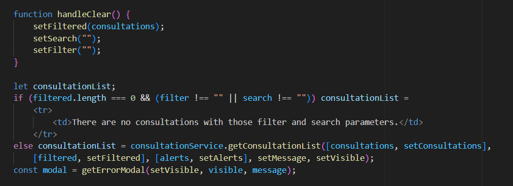

---

### 2) Clean code: lógica simple y explícita (“straightforward logic”)
**Técnica:** preferir una lógica directa para que sea difícil que los bugs “se escondan”; usar ramas claras y evitar condiciones densas. 

**Ejemplo**

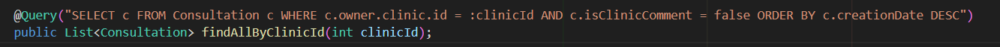

---

### 3) Clean code: dependencias mínimas (“minimal dependencies”)
**Técnica:** reducir dependencias y acoplamientos para facilitar cambios y mantenimiento; evitar duplicar reglas de negocio en múltiples sitios. 

**Ejemplo**


Como vemos en la captura del código al filtrar en el backend el endpoint en el frontend ya devuelve los datos filtrados por lo que evita duplicar la regla de negocio en sitios distintos. 

---

### 4) Clean code: manejo de errores completo (con estrategia)
**Técnica:** el error handling debe ser **completo** y seguir una estrategia; no asumir que entradas externas existen (API, formularios, parámetros). 

**Ejemplo**

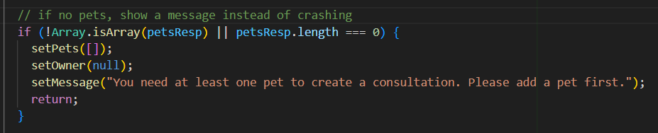

---

### 5) Clean code: rendimiento cercano a óptimo sin “optimización sin principios”
**Técnica:** evitar optimizaciones prematuras que ensucian el código; priorizar claridad y solo optimizar con evidencia (medición/profiling). 

**Ejemplo**

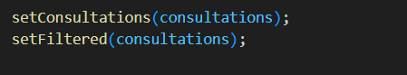

Aquí estamos realizando una buena práctica de clean code ya que estamos guardando el array y filtrandolo, sin realizar ninguna optimización prematura.

---

### 6) “Hace una cosa bien” (Single Responsibility) aplicado a código y PRs
**Técnica:** dividir responsabilidades para que el cambio sea local y revisable; aplicar SRP también a los Pull Requests manteniéndolos pequeños y enfocados. 

**Ejemplo**


Este es un buen ejemplo de Single Responsibility ya que el repositorio solo hace el acceso a datos: “dame las consultas de una clínica con este filtro”.  

---

## Políticas de Mensajes de Commit (Commit Message Policies)

Para garantizar la legibilidad del historial y reducir la deuda técnica, nuestro equipo adopta una versión adaptada de la especificación **Conventional Commits 1.0.0**. Todos los mensajes se redactarán en **español** y deberán seguir una estructura estandarizada que permita comprender el historial sin necesidad de inspeccionar el código.

### 1. Estructura Estricta del Commit

Todo commit en este proyecto debe seguir el siguiente formato:

```text
<tipo>[ámbito opcional]: <descripción breve>

[cuerpo opcional explicando el qué y el porqué]
```

### 2. Tipos de Commit Permitidos

El `<tipo>` debe ser obligatoriamente uno de los siguientes:

- **`feat`**: Introducción de una nueva funcionalidad.
- **`fix`**: Corrección de un error (bug).
- **`docs`**: Cambios exclusivos en la documentación.
- **`refactor`**: Reestructuración del código que no añade funcionalidades ni corrige errores.
- **`test`**: Creación o modificación de pruebas.
- **`build`** / **`chore`**: Tareas de mantenimiento, dependencias o configuración.

### 3. Las "8 Reglas de Oro" de la Metodología Base

Basado en las mejores prácticas de la asignatura, todo commit debe cumplir estas reglas:

1. **Separación**: Separar el título del cuerpo con una línea en blanco.
2. **Longitud**: Límite de 50 caracteres para la línea del título.
3. **Mayúscula**: Empezar el título siempre en mayúscula.
4. **Puntuación**: No terminar el título con un punto.
5. **Imperativo**: Usar el modo imperativo (ej. *"Añade validación"* en lugar de *"Añadido"* o *"Añadiendo"*).
6. **Ajuste del cuerpo**: Salto de línea a los 72 caracteres en el cuerpo.
7. **Descriptivo**: Usar el cuerpo para explicar *qué* se ha cambiado y *por qué*, no *cómo*.
8. **Atomicidad**: Un commit = un solo cambio lógico. No mezclar cambios independientes en un mismo commit.

### 4. Directrices Propias del Equipo (Custom Policies)

Para adaptar la metodología a nuestra forma de trabajar y evitar problemas comunes, hemos establecido las siguientes normativas internas:

- **Trazabilidad sin Auto-cierre**: Para referenciar una tarea (Issue) sin que GitHub la mueva automáticamente a "Done", se incluirá el número de la Issue directamente dentro del ámbito del título.

  Ejemplo:

  ```text
  <feat>(#12): Añade funcionalidad A1.4.2 petclinic frontend
  ```

  Quedan estrictamente prohibidas palabras clave de cierre automático como `Fixes #12` o `Closes #12`.

- **Lista Negra de Mensajes (Anti-basura)**: Quedan terminantemente prohibidos los mensajes vagos que no aportan valor semántico.

  No se aceptarán commits con títulos como *"wip"*, *"arreglos"*, *"cambios"*, *"prueba"*, *"ahora sí"* o *"fix bug"*.

- **Frecuencia Mínima (Commit de seguridad)**: Es obligatorio realizar al menos un commit y subirlo a la rama remota correspondiente (push) al finalizar la jornada o sesión de trabajo de cada miembro.

  El objetivo es evitar dejar código sin respaldar en local y asegurar que el equipo pueda ver el progreso real del trabajo en todo momento. No se debe esperar a que una funcionalidad esté completamente terminada para hacer commit. Subir avances parciales permite que los compañeros sepan en qué estado se encuentra cada tarea y reduce el riesgo de no llegar a una entrega por problemas imprevistos.


- **Calidad Garantizada (Pre-commit)**: Queda prohibido hacer commit de código roto o que no haya sido verificado localmente.

  El proyecto debe compilar y funcionar correctamente antes de registrar el cambio para no perjudicar ni interrumpir el flujo del resto del equipo.

---

## 3) Estructura de Repositorios y Ramas por Defecto (Structure of Repositories and Default Branches)

Con el objetivo de garantizar la organización, trazabilidad y estabilidad del desarrollo, el equipo adopta una estrategia de repositorios y ramas basada en las mejores prácticas de Git y alineada con el flujo de trabajo de GitHub.
Así, definimos en común la estructura del repositorio, el propósito de cada rama y las normas obligatorias para su uso.

## 1. Estructura General del Repositorio

El repositorio del proyecto deberá mantener una estructura clara y coherente, que incluye:
```text
/
├── src/          # Código fuente principal del backend de la aplicación
├── docs/         # Documentación técnica y funcional
├── frontend/     # Código fuente principal del frontend de la aplicación
├── README.md     # Descripción general del proyecto
├── LICENSE       # Licencia del proyecto
└── .gitignore    # Exclusiones del control de versiones
```

Reglas Obligatorias:

1. Separación de responsabilidades: El código de backend no debe mezclarse con el de frontend o la documentación (y viceversa).

2. Documentación del proyecto: El repositorio debe incluir una documentación útil y actualizada conforme al Product Backlog de la asignatura.

3. Estructura consistente: Todas las ramas del equipo deben mantener la misma jerarquía base, y no se deben realizar modificaciones sin consultar al resto del equipo.

Con estas reglas sencillas se pretende mantener un espacio de trabajo limpio y ordenado, tratando por todos los medios de evitar el acumulamiento de deuda técnica y fomentar, en cambio, una estructura intuitiva que nos permita acceder rápidamente a los ficheros que nos interesen.

Como ejemplo concreto, hemos definido como grupo una subestructura de la carpeta docs en la que organizamos las distintas imágenes, documentos y reports de forma que queden todos agrupados por clase y/o por tarea. Esto nos permite acceder fácilmente a los documentos que nos interesan para facilitar la consulta y seguimiento de las metodologías, o la modificación de imágenes en caso de necesitarlo.

### 2. Ramas por Defecto del Proyecto

El desarrollo de nuevas funcionalidades en el proyecto se llevará a cabo en diferentes ramas de trabajo según un modelo inspirado en Git Flow que describimos más en detalle en el siguiente apartado del documento, "Estrategia de Ramificación y Revisiones por Pares". Sin embargo, cabe destacar el papel que jugarán algunas ramas concretas en nuestra metodología de trabajo.

La rama `main` será la rama principal del proyecto, a la que nunca se deberá hacer commit directamente. Todas las contribuciones a la rama `main` deberán hacerse mediante la  Pull Requests desde la ramas `release` o `develop`, pasando por una validación por otros miembros del equipo antes de aceptarse. Siempre contendrá versiones estables del proyecto, y en el caso excepcional de que encontremos errores graves en ella los arreglaremos mediante commits a la rama `hotfix`. 

Las rama `develop` será la rama en la que más contribuciones se harán, centradas en features y siempre a través de la creación de ramas específicas de issues a partir de `develop`. La utilizaremos como la rama en la que iteraremos y probaremos las contribuciones al proyecto en versiones en progreso, utilizando una rama por issue y apoyándonos en los Pull Requests para tratar de mantener la calidad de código y documentación en ella, aunque no siempre tendrá versiones estables.

Éstas dos últimas ramas se considerarán las principales, pero como ejemplo de rama especial utilizaremos también `release` para desplegar el proyecto como herramienta web y probar así nuevas features en entornos que no sean de desarrollo. Es una rama que se creará siempre desde `develop` y acabará siendo mergeada a la rama `main`, y la usamos como forma de hacer modificaciones ágiles a los problemas que detectemos sin necesidad de modificar ramas más protegidas como `main` y `develop`.  


### 3. Reglas de Protección de las Ramas por Defecto

Para garantizar la estabilidad del proyecto, deben cumplirse las siguientes normas:

1. **Contribuciones a las ramas principales**: Se podrán realizar únicamente mediante Pull Requests, nunca mediante commits.
2. **Peer Review**: Ningún miembro del equipo podrá aceptar sus propios Pull Requests, para asegurar la calidad de la contribución deberá ser revisada por al menos otro miembro del equipo.
3. **Proyecto funcional**: Las contribuciones a la rama principal nunca podrán causar fallos en las funcionalidades del proyecto, deben ser completas y estar testadas.

### 4. Responsabilidad del Equipo

En este proyecto, todos los miembros del equipo tenemos un compromiso mutuo de realizar un buen trabajo siguiendo las metodologías que decidimos en común. Por ello, y para mantener el orden en el proyecto en conjunto, cada miembro del equipo se compromete a:
- **Mantener la limpieza estructural**
- **Respetar la jerarquía de ramas por defecto**
- **Seguir la estructura establecida del proyecto**
---

## 4) Estrategia de Ramificación y Revisiones por Pares

Para gestionar nuestro código trabajaremos bajo la metodología Git Flow, manteniendo dos ramas principales de vida infinita: main (código en producción) y develop (código integrado para la próxima versión).
Nuestras normas de trabajo diario serán las siguientes:

* Toda rama nueva se creará obligatoriamente desde GitHub usando la opción "Create branch from issue" para que quede vinculada automáticamente a su tarea correspondiente.
* Las fusiones directas están prohibidas. Para integrar cualquier cambio en develop o main, utilizaremos Pull Requests de GitHub para garantizar la revisión por pares.
* Las revisiones por pares será de la siguiente manera,  una vez que hayas terminado una tarea debes crear una Pull Request, esta será revisada por algún compañero, que no haya intervenido en el desarrollo de la tarea, para comprobar que no haya ningún error que pueda dañar la rama main y todos los cambios que se suban a la rama principal sean correctos.
* Las Pull Requests serán obligatorias en todos los casos, incluso si un desarrollador está trabajando en solitario.

## Desarrollo de Nuevas Funcionalidades

Para añadir nuevo código al proyecto:

1. Crearemos ramas de características (feature/nombre) partiendo siempre de la rama develop. Estas ramas se subirán y publicarán en nuestro repositorio remoto.
2. Al terminar la tarea, el desarrollador abrirá una Pull Request hacia develop.
3. La fusión se realizará asegurándonos de aplicar la opción --no-ff (sin avance rápido) para generar y conservar un commit de merge en el historial.


## Preparación de Lanzamientos

Cuando el código de develop esté listo para publicarse:

1. Crearemos una rama release/X.Y.Z partiendo de develop para realizar únicamente ajustes finales, arreglos menores y actualización de la versión.
2. Para cerrarla, la fusionaremos primero en main (con --no-ff) y le asociaremos un Tag con el número de la versión lanzada.
3. Inmediatamente después, la fusionaremos de vuelta en develop (con --no-ff) para que la rama de desarrollo reciba esos últimos ajustes.
4. Excepción de la regla general: Estas fusiones de release las realizaremos directamente mediante comandos en Git, sin utilizar Pull Requests.


## Corrección de Errores en Producción (How to fix bugs in production)
Si detectamos un error crítico en el código:
1. Crearemos una rama hotfix/X.Y.Z que nacerá directamente desde main.
2. Una vez corregido el fallo, aplicaremos el mismo patrón que en los lanzamientos: fusionaremos en main (con --no-ff), crearemos un Tag con el parche de versión actualizado, y finalmente fusionaremos en develop (con --no-ff).
3. Al igual que con las releases, estas fusiones de emergencia se integrarán directamente por comandos sin requerir Pull Request.


## 5) Políticas de Versionado del Proyecto

El presente documento establece las directrices normativas para la asignación de versiones al software desarrollado en el marco de la asignatura Proceso Software y Gestión II. Esta política adopta el estándar de **Versionado Semántico (SemVer)** como base metodológica. El objetivo es asegurar que la evolución del proyecto sea clara, predecible y comprensible para todos los miembros del equipo.

### 1. Estructura de la Versión

El formato de versionado se compondrá de tres números principales separados por puntos, siguiendo la estructura **X.Y.Z**.

Cada uno de estos componentes representa lo siguiente:

- **X (Major version)**: Representa la versión mayor del software.
- **Y (Minor version)**: Representa la versión menor del software.
- **Z (Patch version)**: Representa los parches aplicados a la versión.

**Ejemplo:**
```
0.1.3  → Versión inicial en desarrollo con funcionalidades menores y parches
1.0.0  → Primera versión estable y pública
2.1.5  → Segunda versión mayor con funcionalidades nuevas y correcciones
```

### 2. Reglas de Incremento de Versión

El incremento de cada número dependerá de la naturaleza de los cambios introducidos en el código. Todas las reglas siguientes deben aplicarse de forma rigurosa.

#### 2.1 Versión Mayor (Major - X.y.z)

Se incrementará únicamente cuando se realicen **cambios mayores** en el sistema.

- Este incremento indica que los cambios **rompen la compatibilidad de la API** con versiones anteriores.
- Para las fases de desarrollo inicial del proyecto, se utilizará la versión base **0.y.z**.
- La liberación de la versión **1.0.0** definirá la **primera API pública y estable** del proyecto.
- **Regla de reinicio obligatorio**: Cuando se incrementa la versión Mayor (de X a X+1), los valores de las versiones Menor y Parche **deben reiniciarse obligatoriamente a cero**.

**Ejemplo de transición:**
```
0.5.3 → 1.0.0  (Primera versión estable)
1.2.7 → 2.0.0  (Cambios incompatibles con la API anterior)
```

#### 2.2 Versión Menor (Minor - x.Y.z)

Se utilizará para denotar **cambios menores** en el sistema.

- Se incrementará cuando se **incluya nueva funcionalidad sustancial** o **mejoras importantes** en el proyecto.
- Esta versión puede llegar a incluir **parches de código** en su integración.
- A diferencia de la versión Mayor, el incremento de la versión Menor **no rompe la compatibilidad de la API**.
- **Regla de reinicio obligatorio**: Cuando se incrementa la versión Menor (de Y a Y+1), el valor del **Parche debe reiniciarse obligatoriamente a cero**.

**Ejemplo de transición:**
```
1.0.0 → 1.1.0  (Nueva funcionalidad añadida)
1.1.3 → 1.2.0  (Mejora importante introducida)
```

#### 2.3 Versión de Parche (Patch - x.y.Z)

Este número se incrementará **exclusivamente** para la **corrección de errores** (bug fixes).

- Solo comprenderá **cambios internos** orientados a corregir comportamientos incorrectos del software.
- La aplicación de un parche **no rompe la compatibilidad de la API**.
- Estos cambios son de naturaleza urgente y no requieren esperar a un lanzamiento de versión menor.

**Ejemplo de transición:**
```
1.2.0 → 1.2.1  (Corrección de un bug crítico)
1.2.1 → 1.2.2  (Corrección de otro error en la misma versión)
```

### 3. Etiquetas Adicionales y Lanzamientos (Releases)

Para gestionar de forma más granular el estado del proyecto, especialmente de cara a entregas o revisiones de la asignatura, se emplean etiquetas y tags específicos.

#### 3.1 Etiquetas Adicionales (Suffix)

Las etiquetas adicionales **(x.y.z-LABEL)** se podrán añadir anexas al final del número de versión. Estas se utilizarán para denotar:

- **Versiones pre-lanzamiento**: Por ejemplo, `-rc` para Release Candidates, `-alpha` para versiones alfa, `-beta` para versiones beta.
- **Metadatos de construcción**: Información adicional sobre la compilación o el estado del software.

**Ejemplo de etiquetas:**
```
1.0.0-rc1      → Release Candidate 1 para la versión 1.0.0
1.0.0-alpha    → Versión alpha de 1.0.0
1.0.0-beta.2   → Segunda versión beta de 1.0.0
```

#### 3.2 Gestión de Tags en el Repositorio

- Cada **lanzamiento (release)** que se genere en el repositorio deberá tener un **tag asociado**.
- El tag debe seguir el formato: **v{X}.{Y}.{Z}[-LABEL]** (con la letra "v" al inicio).
- El tag debe contener **la descripción de cambios**, **el tipo de lanzamiento** y **la versión correspondiente**.
- Los tags deben estar asociados a commits específicos que representen puntos estables del proyecto.

**Ejemplo de tags:**
```
v0.1.0         → Primer lanzamiento inicial
v1.0.0-rc1     → Release Candidate 1
v1.0.0         → Primera versión estable
v1.1.0         → Lanzamiento de funcionalidad nueva
v1.1.1         → Parche de corrección
```

### 4. Responsabilidades y Procedimientos

#### 4.1 Cuándo Incrementar Versiones

- **Versión Mayor (X)**: Solo en reuniones de revisión de release o cuando se decida cambiar de forma oficial la API pública.
- **Versión Menor (Y)**: A la finalización de una funcionalidad sustancial que se integra en la rama principal.
- **Versión de Parche (Z)**: Inmediatamente después de identificar y corregir un bug en producción.

#### 4.2 Procedimiento de Lanzamiento

1. Identificar la naturaleza de los cambios realizados desde el último lanzamiento.
2. Determinar qué componente de la versión debe incrementarse (X, Y o Z).
3. Crear un tag en el repositorio con el nuevo número de versión.
4. Documentar los cambios en el registro de cambios o **CHANGELOG** del proyecto.
5. Comunicar el nuevo lanzamiento al equipo y a los interesados.

### 5. Ejemplo de Evolución de Versiones

La siguiente secuencia ilustra cómo evolucionaría el versionado en un ciclo típico:

```
0.1.0  → Primer prototipo funcional
0.1.1  → Corrección de un bug menor
0.2.0  → Añadida funcionalidad de autenticación
0.2.1  → Parche de seguridad
0.3.0  → Añadida funcionalidad de reportes
1.0.0  → Release oficial con API estable
1.0.1  → Corrección de errores post-lanzamiento
1.1.0  → Nuevas características añadidas
2.0.0  → Rediseño mayor que rompe compatibilidad con v1.x
```

---

### 6. Consideraciones Finales

- **Coherencia**: Todos los miembros del equipo deben utilizar esta política de versionado de forma consistente.
- **Transparencia**: El número de versión debe reflejar fielmente la naturaleza de los cambios realizados.
- **Comunicación**: Cualquier cambio en la política de versionado debe comunicarse al equipo en la siguiente reunión.


## 6) Definición de "Terminado" (Definition of "Done")

La Definition of "Done" establece los criterios obligatorios que debe cumplir cualquier contribución al proyecto para considerarse completamente terminada. El objetivo es garantizar la calidad del trabajo y la coherencia del proyecto en conjunto en todas las entregas, asegurándonos de que todo el equipo trabaja siguiendo las mismas metodologías ágiles.
Aunque en un proyecto real la condición final de "hecho" es contar con la aprobación del Product Owner, en este proyecto no seguimos un ciclo de desarrollo estándar, por lo que un elemento no se considerará terminado hasta que cumple todos los puntos descritos en este documento.

### 6.1. Objetivo principal

El concepto de hacer una definición de "hecho" se basa en que no podemos contentarnos con que el código o la documentación que hayamos contribuido cumpla nuestros estándares personales, sino que debe haber un consenso de que la contribución está lista para integrarse con el proyecto sin causar problemas con el despliegue o deuda técnica.

Es por ello que consideramos que todas las contribuciones al proyecto deben seguir la definición de "hecho", no únicamente las que contribuyen código sino también las que modifican la estructura del proyecto, la documentación, etc.

En general, una contribución no se considerará completada hasta que no pase por un peer review y se testee el proyecto por completo para comprobar que no causa errores en otras funcionalidades. Además de esto, deberán cumplir otros criterios detallados a continuación.

En concreto, en nuestro proyecto nos ayudaremos de la definición de hecho para fomentar, entre otras cosas, la interacción entre los miembros del equipo y el que todos los desarrolladores estén familiarizados con las tareas en las que trabaja el resto, lo que nos permitirá un control más efectivo sobre la calidad general de las contribuciones.

### 6.2. Criterios Obligatorios

Toda contribución al proyecto deberá cumplir las siguientes condiciones según el tipo de contribución del que se trate:
#### 6.2.1 Código
* Compila sin errores.
* No contiene código comentado innecesario.
* No introduce warnings críticos.
* Sigue las reglas de estilo definidas por el equipo.

#### 6.2.2 Pruebas
* Incluye pruebas automatizadas cuando aplique.
* Las pruebas existentes pasan correctamente.
* La cobertura no disminuye respecto a la rama base.
* Incluye pruebas sobre casos límite.

#### 6.2.3 Integración
* No existen conflictos sin resolver.
* Se ha comprobado que no causa que funcionalidades anteriores dejen de funcionar.

#### 6.2.4 Pull Requests
* Cumplir completamente los criterios de aceptación definidos.
* Resolver el problema descrito en la tarea.
* No introducir regresiones en funcionalidades existentes.
* Ser validado manualmente si el cambio afecta a la interfaz de usuario.

#### 6.2.5 Documentación
Según la naturaleza del cambio, debe actualizarse:
* README.md si cambia comportamiento general.
* Documentación técnica si se modifica arquitectura.
* Registro de cambios (changelog) si es necesario.

#### 6.2.6 Revisión de Código (Code Review)
* Ningún trabajo se considera terminado sin revisión.
* Al menos un miembro del equipo debe aprobar el cambio.
* Los comentarios deben resolverse antes del merge.
* No deben existir conversaciones abiertas.
* El autor debe responder y justificar decisiones técnicas si se solicitan.---

## 7. Gestión de Documentos en el Repositorio

En nuestro proyecto, aplicamos la Gestión de la Configuración a todos los artefactos, lo que incluye tanto el código de React Petclinic como la documentación generada. Nuestro objetivo es tener el mismo nivel de control, calidad y trazabilidad en los textos que en el software, tratando la documentación como auténtico código.

---

## 7.1. El uso de Markdown como estándar

Toda la documentación oficial del proyecto se redactará en **Markdown (.md)** y se almacenará en el directorio `/docs`.

### ¿Por qué es útil para el proyecto?

Los archivos de procesadores de texto (como Word o PDF) son formatos binarios. Si modificamos una sola frase en un Word, Git solo detecta que el archivo ha cambiado por completo, pero no muestra qué contenido exacto varió.

Al usar Markdown (texto plano), el motor de Git puede rastrear los cambios línea por línea.

Esto nos permite que, al hacer una revisión en GitHub, la plataforma nos resalte exactamente la frase que un compañero ha añadido o borrado, agilizando enormemente el proceso de revisión y detección de errores.

---

## 7.2. Política de Nomenclatura según la Naturaleza del Documento

Para mantener el repositorio limpio y organizado, hemos clasificado la documentación en dos grandes grupos, aplicando una política de nombres distinta a cada uno:

### 📌 Documentos de Registro (Eventos temporales)

Son aquellos que recogen lo sucedido en un momento concreto del desarrollo, como:

- Actas de reuniones  
- Sprint Reviews  
- Retrospectives  
- Plannings  
- Daily Stand-ups  

**Nomenclatura:** Al ser recurrentes, llevarán siempre la fecha en el título para que se ordenen cronológicamente de forma automática.

**Formato:** `YYYY-MM-DD-[Tipo_de_Evento].md`  

**Ejemplo:** `2026-02-25-Sprint-Review.md`

---

### 📌 Documentos Permanentes (Artefactos vivos)

Son documentos técnicos de larga duración que evolucionan con el proyecto, como:

- El presente informe de metodología de configuración  
- Estándares de codificación  
- ...

**Nomenclatura:** Tendrán un nombre descriptivo sin fecha en el título, ya que su contenido no pertenece a un día concreto, sino que se actualiza constantemente.

**Formato:** `[Nombre_Descriptivo].md`  

**Ejemplo:** `Informe-Metodologia-Configuracion.md`

---

## 7.3. Versionado Interno de los Documentos

Los **Documentos de Registro** (actas, reviews) actúan como un historial inmutable de un evento pasado, por lo que una vez redactados y aprobados, no requieren control de versiones continuo.

Sin embargo, los **Documentos Permanentes** sí están sujetos a cambios.

Para estos archivos, estableceremos un control de versiones interno. Cada documento permanente incluirá una tabla obligatoria al inicio con los siguientes metadatos:

| Campo                    | Descripción |
|--------------------------|------------|
| Versión                  | Formato numérico sencillo (Ej: v1.0 para la primera versión oficial, v1.1 para actualizaciones menores) |
| Fecha de modificación    | Fecha del último cambio realizado |
| Autor                    | Responsable de la modificación |
| Descripción del cambio   | Resumen muy breve de la actualización |

### ¿Por qué es útil?

Esta tabla permite a cualquier miembro del equipo, o a un evaluador externo, saber de un simple vistazo si está leyendo la versión más actualizada del informe y qué fue lo último que se modificó, sin necesidad de explorar el historial técnico de commits en Git.

---

## 7.4. Control de Cambios, Zenhub y Revisión por Pares (Peer Review)

Al igual que un bug en el código puede romper la aplicación, un error en la documentación técnica puede generar confusión o deuda técnica en el equipo. Para controlar esto sin generar burocracia excesiva, aplicamos las siguientes reglas:

### Trazabilidad en Zenhub
Todo cambio debe estar justificado:
- **Cambios menores o mayores:** Si es una actualización sustancial (ej. rehacer el modelo de datos o añadir un nuevo apartado a un informe), o si son correcciones pequeñas (ortografía, actualización de enlaces o formatos), aunque por más pequeña y rapida que sea, se creará una **Issue específica** en Zenhub.

### Ramas y Pull Requests
- Cualquier creación o modificación de un documento se realizará en una rama de trabajo independiente (ej. `docs/actualizar-normas`).
- Para integrar ese documento en la rama principal, será obligatorio abrir una **Pull Request**.

### Evitar cuellos de botella (Peer Review)
No exigiremos que todo el equipo revise cada documento, ya que esto bloquearía el flujo de trabajo del Sprint. Será suficiente y obligatorio que **al menos un miembro del equipo distinto al autor** realice la Revisión por Pares. Este compañero deberá leer el documento, comprobar su formato, ortografía y exactitud técnica, y aprobar (*Approve*) los cambios antes de fusionarlos.


# Objetivo y Scope de la CMDB (Objective and Scope of the CMDB)

Una CMDB (Configuration Management Database) es una base de datos que almacena información sobre los Configuration Items (CIs) de una organización y las relaciones entre ellos. La Gestión de la Configuración (Configuration Management, CM) define los métodos y técnicas necesarios para identificar, controlar y mantener la integridad de todos los artefactos desarrollados en los procesos de software. En nuestro proyecto, nos ayudaremos de la CMDB para asegurar la calidad del trabajo y la compatibilidad con todos los sistemas que utilizamos para desarrollarlo, permitiéndonos:
* Garantizar la validez de los artefactos.
* Controlar su evolución.
* Asegurar su disponibilidad.
* Gestionar los artefactos de manera estructurada.

### 1. Objetivo de la CMDB

El objetivo principal de la CMDB es centralizar la información de todos los Items de Configuración (CIs) para facilitar el control de los cambios realizados sobre dichos elementos. Asimismo, nos permitirá definir responsabilidades claras sobre estos artefactos, facilitar la trazabilidad y auditoría de los cambios en caso necesario y, crucialmente, mantener la coherencia entre entornos para asegurar la compatibilidad de los sistemas desarrollados en todo momento. Por ejemplo, en la CMDB clasificaremos Items como repositorios, documentación técnica, servidores y PCs o entornos de desarrollo.
Así, con la ayuda de la CMBD podremos comprender fácilmente el estado actual del proyecto, su historial de cambios y las dependencias entre componentes, y nos permitirá reducir riesgos asociados a cambios no controlados, evitar inconsistencias entre entornos y mejorar la capacidad de auditoría. Proporciona transparencia y claridad sobre qué elementos existen, quién es responsable de ellos y cómo deben gestionarse los cambios.

### 2. Scope de la CMDB

El alcance de la CMDB se divide en dos niveles principales: organizacional y de proyecto.

A nivel organizacional, la CMDB establece las directrices generales de gestión de configuración. Esto incluye la definición de roles, políticas de versionado, estándares de nomenclatura y el procedimiento de gestión de cambios. También determina qué herramientas serán utilizadas para registrar y mantener la información, así como los mecanismos de auditoría y control. Por ejemplo, en nuestro proyecto, nos permitirá clasificar herramientas que usamos en común como Visual Studio Code y asegurarnos de que no existen incompatibilidades entre versiones.

A nivel de proyecto, el alcance se concreta en la identificación específica de los Configuration Items que forman parte del desarrollo. Cada proyecto debe definir qué elementos serán considerados CIs, cómo serán versionados y quién será responsable de su mantenimiento.

El scope también incluye la gestión de las relaciones entre CIs. No basta con identificar componentes de manera aislada; es importante clasificar el cómo interactúan entre sí y qué impacto puede tener un cambio en un elemento sobre los demás. Por ejemplo, es importante tener asociados el PC de un miembro del equipo con el software que usa para comprender mejor la situación de desarrollo del mismo.

### Gestión de Entornos
Los entornos de desarrollo, pruebas y producción forman parte del alcance de la CMDB y deben gestionarse como Configuration Items independientes. Cada entorno posee una configuración específica que debe estar documentada y controlada.

Ésto nos permitirá asegurar coherencia entre ellos, evitando problemas derivados de diferencias que no tengamos controladas. Cualquier modificación en la infraestructura, versiones de software, configuraciones de red o dependencias externas debe quedar registrada en la CMDB.

Asimismo, cada entorno debe tener responsables claramente definidos (sus "propietarios"), quienes velarán por la correcta actualización de su información y la aplicación controlada de cambios. En nuestro caso, y para simplificar el management, los responsables de cada ordenador y el software que usen será el propietario del sistema, y definiremos responsables de los sistemas compartidos.

### Configuration Management Plan
El Configuration Management Plan (CMP) es el documento que define el uso de la CMDB dentro de un proyecto u organización. En él se especifican los métodos y técnicas que se utilizarán para llevar a cabo la gestión de configuración.

El CMP debe describir cómo se identificarán los CIs, qué criterios se utilizarán para clasificarlos y cómo se gestionará su versionado. También debe detallar el proceso de gestión de cambios, indicando cómo se solicita un cambio, quién lo evalúa, quién lo aprueba y cómo se implementa.

Además, el plan debe definir claramente las responsabilidades asociadas a cada CI, así como la figura responsable de la gestión global de la configuración y del mantenimiento de la CMDB. Otro aspecto fundamental es el procedimiento de reporte, que debe garantizar que todos los cambios queden registrados con información sobre fecha, responsable e impacto.

### Resumen del uso de CMDB en el proyecto
En resumen, la CMDB constituye un elemento fundamental para asegurar la coherencia, trazabilidad y control dentro de cualquier proyecto de desarrollo de software. La definición del alcance permiten establecer una base sólida para la gestión estructurada de los activos y configuraciones.

Al definir claramente el objetivo y el scope de la CMDB, mejoraremos enormemente nuestra capacidad de control y auditoría, sino que también incrementa la estabilidad de sus entornos y reduce riesgos asociados a cambios no gestionados. En consecuencia, la CMDB se convierte en un pilar estratégico para garantizar la calidad y sostenibilidad del sistema a lo largo del tiempo.

Además, le hemos dado especial importancia a clasificar en la CMBD el software que usamos junto a las versiones específicas de cada miembro del equipo, lo que nos permitirá tener un mejor control de las posibles discrepancias que surjan entre diferentes sistemas, así como diagnosticar más fácilmente errores dados por estas diferencias.

En concreto en nuestro proyecto el generar estas herramientas de organización nos permitirán, como grupo, seguir un ritmo de trabajo más ágil y mantener una comunicación efectiva con el resto de miembros del equipo, asegurándonos un mejor entorno de trabajo en el que tendremos las facilidades para centrar nuestros esfuerzos en el desarrollo de buen código y documentación sin tener que malgastar tiempo en resolver incompatibilidades innecesarias.


# Gestión de la CMDB e Infraestructura (iTop)

Nuestra CMDB en iTop tiene como objetivo mantener un registro actualizado y centralizado de todos los **Elementos de Configuración (CIs)** que soportan el entorno de trabajo del grupo. 

Aunque el desarrollo de *nuestro proyecto* se realice de forma distribuida utilizando nuestros propios equipos, la CMDB nos permite modelar este entorno para realizar análisis de impacto y gestionar incidentes de forma profesional.

### 1. Estructura de la CMDB

Nos hemos organizado bajo una **Organización** principal ("Grupo X - PSG2") a la que pertenecen todos los miembros del equipo. Hemos categorizado los CIs en cuatro grandes grupos para reflejar nuestro entorno real:

1. **Hardware (Dispositivos Físicos):** Los equipos personales (Laptops/PCs) que cada miembro aporta al proyecto.

2. **Software de Base y Desarrollo (Instancias de Software):** Sistemas operativos y entornos de ejecución. Controlar las **versiones exactas** de estos CIs es vital; si un desarrollador experimenta un fallo que otros no, la CMDB nos permite verificar rápidamente si existe una discrepancia de versiones en su entorno local.

3. **Servicios y Servidores Cloud:** Infraestructura externa compartida necesaria para el alojamiento o despliegue.

4. **Documentos Técnicos:** Artefactos no ejecutables pero críticos para la viabilidad del proyecto. 

**¿Por qué incluimos los documentos en la CMDB?**
En la Gestión de la Configuración, un CI es cualquier elemento del que dependa el proyecto. Si un nuevo desarrollador se incorpora al equipo hoy, para poder empezar a programar no solo depende de tener su portátil y el software correspondiente instalado; también tiene una dependencia total y absoluta de leer el *Informe de Metodología*. Si este documento no existe, tiene errores o no se le ha asignado un responsable que lo actualice, el nuevo desarrollador hará commits incorrectos, se saltará las Pull Requests y romperá el repositorio. Por tanto, la documentación ejerce un servicio directo sobre el equipo y debe registrarse en iTop.

### 2. Inventario de CIs y Relaciones por Miembro

A continuación, se detalla una muestra de los CIs registrados en iTop. Cada instancia de software está relacionada mediante un vínculo de dependencia (*Depends on*) con el equipo físico que la aloja:

A continuación, se detalla una muestra representativa de los CIs registrados en iTop. Cada instancia de software está relacionada mediante un vínculo de dependencia (*Depends on*) con el equipo físico que la aloja:

| Propietario / Responsable | Elemento de Configuración (CI) | Tipo de CI en iTop | Versión / Detalles |
|---------------------------|--------------------------------|---------------------|--------------------|
| **Ignacio Fuertes(NVV3882)** | Laptop Lenovo Legion 5 | PC | 16GB RAM, WINDOWS 11 |
| | Maven | PC software | 3.6.2 |
| | Node.js | PC software | 22.1.1 |
| | Java (JDK) | PC software | 22.0.1 |
| | Visual Studio Code | PC software | 1.109.5 |
| | Git | PC software | 2.51.2 |
| | Microsoft Edge | PC software | 145.0.3800.70 |
| | Blackboard | PC software | Web |
| | Clockify | PC software | Web |
| | Zenhub | PC software | Web |
| | Github | PC software | Web |
| **Mario Dominguez(mardomlop11)** | Laptop Lenovo Legion 5 | PC | 16GB RAM, WINDOWS 10 |
| | Maven | PC software | 3.6.2 |
| | Node.js | PC software | 22.13.0 |
| | Java (JDK) | PC software | 21.0.10 |
| | Visual Studio Code | PC software | 1.109.5 |
| | Git | PC software | 2.51.2 |
| | Firefox | PC software | 135.0.1 |
| | Blackboard | PC software | Web |
| | Clockify | PC software | Web |
| | Zenhub | PC software | Web |
| | Github Desktop | PC software | 3.5.4 |
| **Pablo Reche(UHN5646)** | Laptop Lenovo Legion 5 | PC | 16GB RAM, WINDOWS 11 |
| | Maven | PC software | 3.6.2 |
| | Node.js | PC software | 22.1.1 |
| | Java (JDK) | PC software | 22.0.1 |
| | Visual Studio Code | PC software | 1.109.5 |
| | Git | PC software | 2.51.2 |
| | Microsoft Edge | PC software | 145.0.3800.70 |
| | Blackboard | PC software | Web |
| | Clockify | PC software | Web |
| | Zenhub | PC software | Web |
| | Github | PC software | Web |
| **Diego Vicente Camara(RXW1249)** | Laptop Lenovo Legion 5 | PC | 16GB RAM, WINDOWS 11 |
| | Maven | PC software | 3.6.2 |
| | Node.js | PC software | 22.1.1 |
| | Java (JDK) | PC software | 22.0.1 |
| | Visual Studio Code | PC software | 1.109.5 |
| | Git | PC software | 2.51.2 |
| | Microsoft Edge | PC software | 145.0.3800.70 |
| | Blackboard | PC software | Web |
| | Clockify | PC software | Web |
| | Zenhub | PC software | Web |
| | Github | PC software | Web |
| **Diego Jose Rodriguez(NCQ5249)** | Laptop Lenovo Legion 5 | PC | 16GB RAM, WINDOWS 11 |
| | Maven | PC software | 3.6.2 |
| | Node.js | PC software | 22.1.1 |
| | Java (JDK) | PC software | 22.0.1 |
| | Visual Studio Code | PC software | 1.109.5 |
| | Git | PC software | 2.51.2 |
| | Microsoft Edge | PC software | 145.0.3800.70 |
| | Blackboard | PC software | Web |
| | Clockify | PC software | Web |
| | Zenhub | PC software | Web |
| | Github | PC software | Web |
| **Organización (Común)**| Repositorio GitHub | Web Application |  |
| | Configuration Management Methodology | Document | Documento Markdown (v1.0) |
| | Google Cloud | Web Aplication | |
## CIs PCs: 
A continuación podemos observar todos los elementos de configuración catalogados como PC, de cada miembro

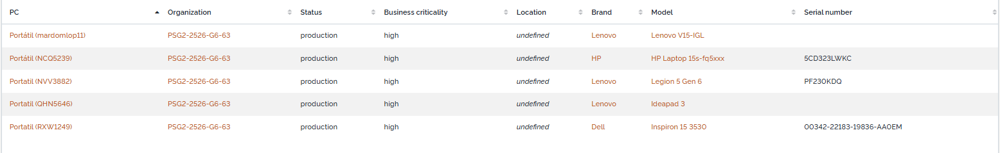


## Cis PC Software de cada integrante del equipo:

A continuación podemos observar todos los elementos de configuración catalogados como PC Software de cada miembro.

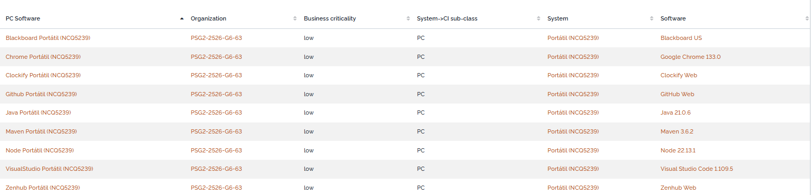
**- PC Softwares de NCQ5239**

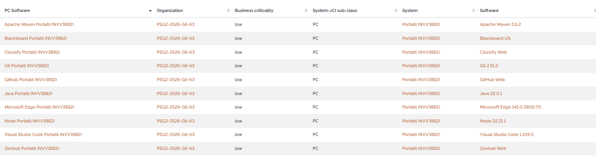
**- PC Softwares de NVV3882**

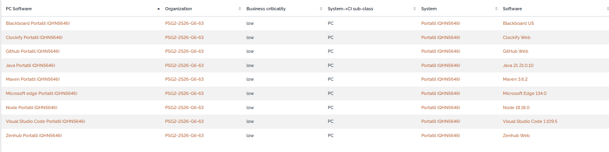
**- PC Softwares de QHN5646**

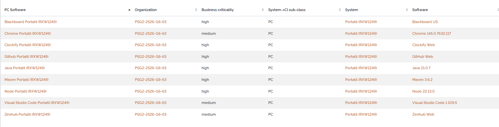
**- PC Softwares de RXW1249**

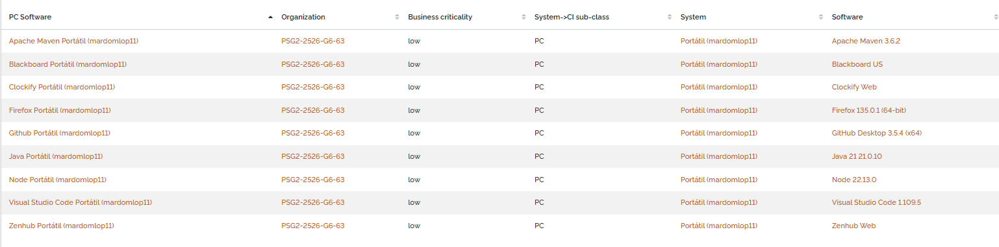
**- PC Softwares de mardomlop11**

## Cis comúnes

A continuación podemos observar todos los elementos de configuración insertados en Itop que son comunes a todos los miembros del equipo.

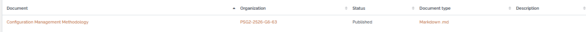
**- Este CI representa al documento actual**

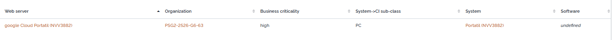
**- Este CI representa la licencia que nos ha aportado la Universidad de Sevilla de google Cloud, que nos permite desplegar nuestra aplicación en la nube**

**- Además, el proyecto con el que trabajamos se encuentra alojado en github, por lo que esta plataforma también se podría contar como un CI común**


### 3. Relaciones y Análisis de Impacto

El verdadero valor de nuestra CMDB no es el inventario en sí, sino las **relaciones de dependencia** establecidas entre los CIs, lo cual nos permite realizar un Análisis de Impacto ante posibles incidentes. 

En iTop, hemos modelado las dependencias siguiendo una estructura de **"abajo hacia arriba" (Bottom-Up)**:
1. **El Hardware soporta al SO:** El Sistema Operativo tiene una relación de dependencia (*Depends on*) con el Laptop físico.
2. **El SO soporta el Software:** Herramientas como Node.js o Java 17 dependen directamente del Sistema Operativo de cada miembro.
3. **Impacto en el Servicio:** Si el portátil de un desarrollador sufre una avería de hardware (Incidente), iTop marcará automáticamente en rojo todas las instancias de software que corren en él. 


De esta forma, si durante un Sprint un miembro reporta que su entorno ha dejado de funcionar, gracias al grafo de relaciones en iTop, el equipo puede saber inmediatamente qué partes de la arquitectura de la *React Petclinic* y qué tareas de Zenhub están en riesgo de no entregarse.
---
<div align="center">
  <sub>ASIGNATURA: PROCESO SOFTWARE Y GESTIÓN II | CURSO: 2025/2026 | GRUPO: G6-63 PETCLINIC | REPOSITORIO: HTTPS://GITHUB.COM/GII-IS-PSG2/PSG2-2526-G6-63</sub>
</div>