<div align="center">
   <br><br>
   <h1>Análisis del Código Fuente y Métricas Asociadas</h1>
   <br>
   
   <br><br>
   <p>
      <strong>ASIGNATURA:</strong> PROCESO SOFTWARE Y GESTIÓN II<br>
      <strong>2025/2026</strong> <br>
      <strong>G6-63</strong> PETCLINIC<br>
      <strong>REPOSITORIO:</strong> HTTPS://GITHUB.COM/GII-IS-PSG2/PSG2-2526-G6-63
   </p>
</div>

<br>
<div align="center">
   <h3>Equipo de Desarrollo</h3>
   Pablo Reche Gabaldón<br>
   Diego Vicente Cámara<br>
   Ignacio Fuertes Montero<br>
   Mario Domínguez López<br>
   Diego José Rodríguez Fernández
</div>
<br>


| Versión | Fecha de modificación | Autor | Descripción del cambio |
|---------|-----------------------|-------|------------------------|
|    1.0     |  26/03/2026  | Mario D.L.  | Métricas generales y overview  |
|    1.1     |  27/03/2026  | Mario D.L.  |  Descripción y análisis de bugs|
|     1.2    |  27/03/2026  | Mario D.L.   | Descripción y análisis de code smells |
|     1.3    |  31/03/2026  | Mario D.L.   | Conclusiones y correcciones del documento |

## Índice

- [Análisis del Código correspondiente al Sprint 1](#análisis-del-código-correspondiente-al-sprint-1)
  - [Vista general del análisis del código](#1-vista-general-del-análisis-del-código)
  - [Bugs en potencia y cómo abordarlos](#2-bugs-en-potencia-y-cómo-abordarlos)
  - [Code Smells y su impacto por tipo](#3-code-smells-y-su-impacto-por-tipo)
  - [Conclusiones del análisis del Sprint 1](#4-conclusiones-del-análisis-del-sprint-1)
- [Análisis del Código correspondiente al Sprint 2](#análisis-del-código-correspondiente-al-sprint-2)
  - [Vista general del análisis del código](#1-vista-general-del-análisis-del-código-1)
  - [Análisis de las métricas respecto al Sprint 1](#2-análisis-de-las-métricas-respecto-al-sprint-1)
  - [Conclusiones del análisis del Sprint 2](#3-conclusiones-del-análisis-del-sprint-2)
- [Conclusiones de la comparación de Sprints](#3-conclusiones-de-la-comparación-de-sprints)

# Análisis del Código Fuente y Métricas Asociadas

Este documento recoge el análisis del código fuente de nuestro proyecto utilizando SonarQube en dos momentos distintos del desarrollo (release S1 y S2), evaluando la rama principal en cada caso. El objetivo es identificar problemas de calidad, analizar métricas clave y proponer mejoras basadas en los resultados obtenidos. Para ello aprovechamos SonarQube como herramienta de inspección estática del código, permitiendo medir aspectos como mantenibilidad, fiabilidad, seguridad y cobertura de pruebas.

El documento se dividirá en el análisis del proyecto en el momento de su primera release (es decir, del trabajo realizado hasta el final del Sprint 1), parte en la que se describirán más en profundidad el significado de las métricas y su relevancia para nuestro proyecto, y una segunda parte en la que se realizará un análisis del proyecto ya habiendo terminado el desarrollo correspondiente al segundo Sprint. Esta segunda parte del documento será más concisa, aprovechando que ya se han explicado las métricas para hacer una comparativa con los datos del primer Sprint.

# Análisis del Código correspondiente al Sprint 1 

## 1. Vista general del análisis del código

A continuación se muestra el dashboard overview proporcionado por SonarQube para la release correspondiente al primer Sprint:
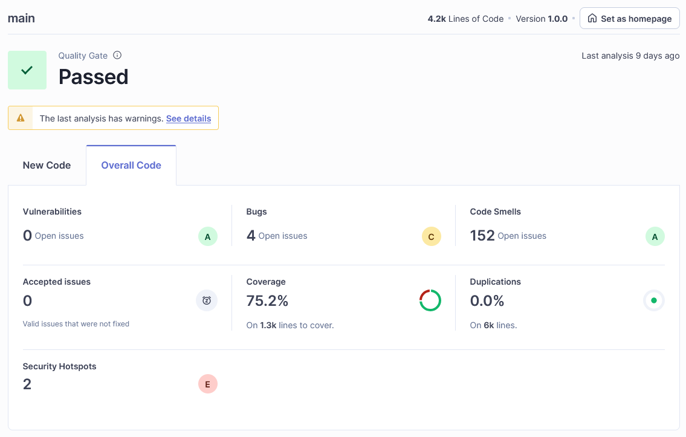

Además, se ha realizado un análisis de la parte del proyecto referente al frontend en el primer Sprint: 
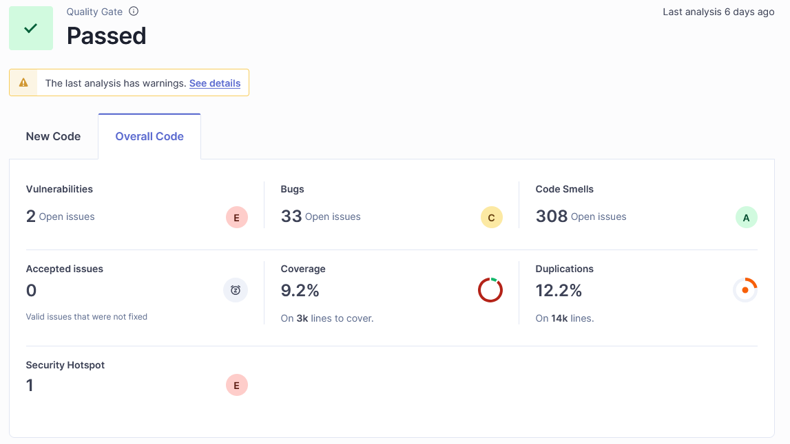

El panel principal de SonarQube ofrece una visión global de la calidad del código a través de las métricas más relevantes.
### Métricas principales:
 * Vulnerabilities (Vulnerabilidades)
   - Descripción: Las vulnerabilidades son problemas de seguridad en el código que podrían ser explotados por atacantes.
   - Valor obtenido en backend: 0
   - Valor obtenido en frontend: 2
   - Interpretación: En el backend el análisis de SonarQube no ha detectado vulnerabilidades, lo cual es un resultado muy positivo desde el punto de vista de seguridad y nos indica que el código no presenta riesgos conocidos. En cuanto al frontend, se han detectado dos posibles vulnerabilidades que, tras revisarse manualmente, se han considerado seguras.
 * Bugs
   - Descripción: Errores potenciales que pueden provocar errores inesperados o fallos mientras se utiliza la aplicación.
   - Valor obtenido en backend: 4
   - Valor obtenido en frontend: 33
   - Interpretación: Hay muy pocos bugs en backend para un proyecto de este tamaño, lo que indica que el sistema es relativamente estable. Aun así, estos problemas deben corregirse para asegurar que no existan fallos en producción. En frontend encontramos un número más elevado de bugs que, para asegurar la estabilidad del sistema, deberemos arreglar conforme avance el desarrollo del proyecto.
 * Code Smells
   - Descripción: Son indicadores de la calidad del desarrollo que no afectan directamente al funcionamiento o la lógica del código, pero sí a su legibilidad y mantenibilidad.
   - Valor obtenido en backend: 152
   - Deuda técnica en backend: 1 día y 2 horas.
   - Valor obtenido en frontend: 308
   - Deuda técnica en frontend: 2 días y 4 horas.
   - Interpretación: Se han detectado muchos code smells, lo que indica que el código puede ser difícil de mantener o evolucionar. De la misma manera, la deuda técnica calculada es bastante elevada, por lo que se debe poner énfasis a futuro en arreglar estos problemas de forma paulatina para que la deuda técnica no aumente exponencialmente conforme se introduzcan nuevas funcionalidades.
 * Coverage (Cobertura de tests)
   - Descripción: Porcentaje del código cubierto por pruebas automatizadas.
   - Valor obtenido en backend: 75.2%
   - Valor obtenido en frontend: 9.2%
   - Interpretación: Se trata de una buena cobertura en backend, aunque mejorable. Indica que la mayor parte del código está testada, pero aún existen partes sin validar que podrían contener errores. Sin embargo, la cobertura de frontend deja mucho que desear, y se debe mejorar urgentemente si queremos asegurar la calidad del código del proyecto y reducir las posibilidades de que lleguen fallos sin detectar a producción.
 * Duplications (Código duplicado)
   - Descripción: Porcentaje de código duplicado en el proyecto, es decir, de partes distintas del proyecto que contienen exactamente las mismas funcionalidades.
   - Valor obtenido en backend: 0.0%
   - Valor obtenido en frontend: 12.2%
   - Interpretación: No existe duplicación de código en la parte de backend, lo cual es un muy buen indicador de buenas prácticas de desarrollo. Asimismo, la duplicación en frontend es relativamente baja, pero nos da pie a realizar un análisis manual del código para detectar posibles mejoras a implementar.
 * Security Hotspots (Puntos clave de seguridad)
   - Descripción: Se tratan de partes del código que requieren una revisión manual para asegurar que no introducen riesgos de seguridad.
   - Valor obtenido en backend: 2
   - Valor obtenido en frontend: 1
   - Interpretación: En total se han encontrado tres puntos que deben ser revisados manualmente. No son necesariamente vulnerabilidades, pero requieren análisis manual por parte de un desarrollador para confirmar que son seguros.

Como podemos observar, SonarQube nos ofrece herramientas muy potentes para hacernos una idea general del estado del proyecto, pero no es una solución mágica a los problemas que detecta. El uso correcto de SonarQube pasa por utilizar la información que nos da de forma inteligente y, como Ingenieros de Software, aprovecharla para prevenir o solucionar problemas de forma eficiente y hacer un seguimiento de buenas prácticas relacionadas tanto con el desarrollo del proyecto como con las metodologías que estemos utilizando.

Además, analizando más en profundidad la deuda técnica que tratamos en el apartado de Code Smells, el análisis nos ofrece una visualización de las distintas clases que forman el proyecto según la cobertura que ofrezcan sus tests, la calidad de su código, su mantenibilidad y la deuda técnica que causan.
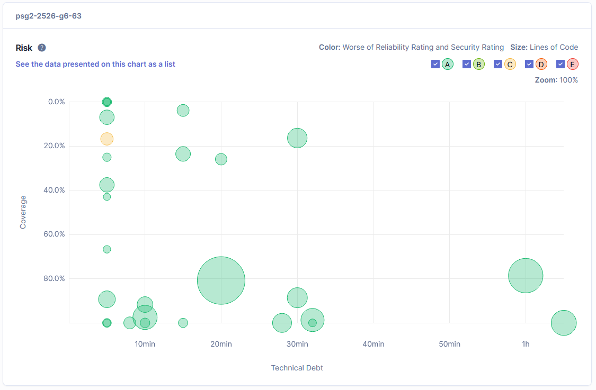

## 2. Bugs en potencia y cómo abordarlos

En la sección Reliability de SonarQube se identifican los bugs potenciales que pueden provocar errores en tiempo de ejecución.

### Tipos de bugs detectados
Algunos de los problemas encontrados incluyen:
 * Null Pointer Dereference
   - Descripción: Acceso a objetos sin comprobar primero si son nulos.
   - Causa: Falta de validaciones previas en variables o resultados de funciones.
   - Severidad: Media, ya que aunque no debería causar problemas si la implementación es correcta, un uso inesperado de la aplicación (como inyección de valores inesperados en la URL) puede provocar fallos en ejecución.
   - Solución: Uso de comprobadores (```if != null```, Optional, anotaciones como @NotNull etc.)
  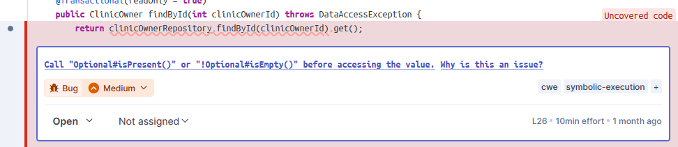
 * Falta de anotaciones de Path
   - Descripción: Si un método tiene paths por defecto y no utiliza la anotación @PathVariable para capturar las variables contenidas en la URL, el framework puede no detectar correctamente esta variable.
   - Causa: Uso de patrón de path con placeholders, pero sin utilizar @PathVariable 
   - Severidad: Media, porque puede llevar a resultados inesperados si el framework no es capaz de leer correctamente las variables de la URL.
   - Solución: Uso de la anotación correspondiente cuando nuestro método trate directamente con Paths.
 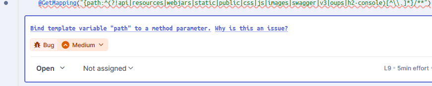

Otros problemas que SonarQube puede ayudarnos a detectar son los siguientes:
 * Condiciones lógicas incorrectas
   - Descripción: Expresiones booleanas mal definidas que pueden provocar errores inesperados.
   - Causa: Errores en operadores lógicos (&&, ||, negaciones, o composición de múltiples operadores).
   - Severidad: Media, dependiendo del impacto en la lógica del sistema.
   - Solución: Revisión de condiciones, uso de tests unitarios y simplificación de la lógica donde sea posible.
 * Recursos no liberados
   - Descripción: Objetos como Streams, promesas o conexiones que no se cierran correctamente.
   - Causa: Mala gestión de recursos
   - Severidad: Media-Alta, puede provocar fugas de memoria.
   - Solución: Uso de try-with-resources o patrones similares, y cierre explícito de los recursos donde sea posible.

## 3. *Code Smells* y su impacto por tipo

Los code smells afectan a la mantenibilidad del código. No son necesariamente fallos de lógica o errores en el código, sino indicadores de que parte de la implementación es difícil de entender, de mantener por otros desarrolladores o que puede llevar a problemas a futuro. A continuación se describen los tipos más relevantes detectados por el análisis de SonarQube.
 * Código sin utilizar: Dispensables (Dead Code)
   - Descripción: Fragmentos de código que no cumplen ninguna función, métodos vacíos, clases que no se usan, etc. 
   - Causa: Falta de planificación a la hora de hacer desarrollo o refactorizaciones mal realizadas.
   - Severidad: Media-Alta, porque aunque el código no utilizado solamente hace más grave la deuda técnica los métodos vacíos pueden llevar a excepciones en tiempo de ejecución si se tratan de usar.
   - Solución: Planificación correcta de refactorizaciones, revisión de clases no utilizadas.
   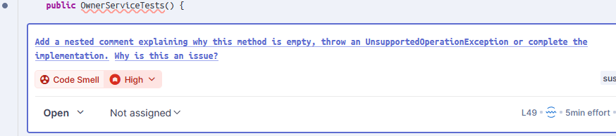
 * Variables e imports no utilizados: Dispensables (Dead Code)
   - Descripción: Declaración de variables o imports que nunca se usan.
   - Causa: Código residual tras refactorizaciones o pruebas, o desarrollo con falta de planificación.
   - Severidad: Baja, porque aunque puede afectar a la memoria que requiere el sistema su impacto es relativamente bajo.
   - Solución: Eliminar variables e imports sin utilizar.
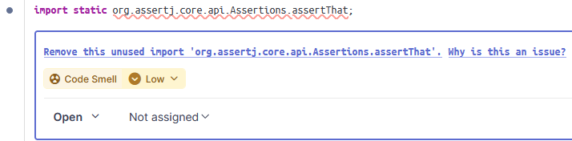
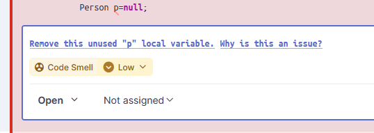
 * Código comentado: Dispensables
   - Descripción: Código sin utilizar en comentarios que hace más difícil la legibilidad y la mantenibilidad.
   - Causa: Refactorizaciones mal aplicadas o un desarrollo incorrecto.
   - Severidad: Media, ya que impacta a la capacidad de los desarrolladores de comprender el código rápidamente, y de modificarlo de forma eficiente a la hora de mantenerlo.
   - Solución: Borrar el código contenido en comentarios.
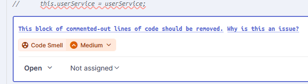

Otros Code Smells que SonarQube nos puede ayudar a detectar son los siguientes:
 * Long Methods (Métodos demasiado largos): Bloater
   - Descripción: Métodos con demasiadas líneas de código o responsabilidades.
   - Causa: Falta de modularización, acumulación de lógica en un único método. En resumen, un método realiza tantas funcionalidades que cumple las funciones equivalentes a varios métodos más pequeños.
   - Severidad: Media, porque aunque no afecta directamente al buen funcionamiento del sistema la existencia de métodos excesivamente grandes lleva a una menor modularidad, y dificulta la comprensión y mantenibilidad de las funcionalidades que lo usan.
   - Solución: Aplicar el principio de responsabilidad única y dividir estos métodos en varios más pequeños.
 * Large Class (Clases con demasiadas responsabilidades): Bloater
   - Descripción: Clases que centralizan demasiada lógica del sistema, que hacen demasiadas funciones.
   - Causa: Crecimiento no controlado del código, o fallos a la hora de hacer un buen diseño del sistema.
   - Severidad: Alta, porque la existencia de este tipo de clases puede llevar a una deuda técnica enorme si se sigue construyendo sobre ellas. Llevan a un código poco flexible y difícil de mantener.
   - Solución: Refactorizar separando responsabilidades en múltiples clases (por ejemplo, dividiéndola en clases Controller, Service, Repository, etc.).

## 4. Conclusiones del análisis del Sprint 1

El análisis con SonarQube ha permitido identificar diversos problemas relacionados con la calidad del código, especialmente en términos de mantenibilidad y fiabilidad. Algunos de los datos más importantes que podemos deducir del análisis son los siguientes:
   * Existencia de un gran número de code smells que incrementan la deuda técnica.
   * Presencia de bugs potenciales que podrían afectar al sistema en producción.
   * Una buena cobertura de pruebas en backend pero deficiente en frontend, que es necesario mejorar. 
   * Una baja cantidad de duplicación y vulnerabilidades, lo cual es muy positivo.
Como oportunidades de mejora que podemos abordar, se encuentran: 
   * Análisis y corrección de los bugs detectados.
   * Revisión de puntos clave de seguridad, y toma de acciones correspondientes en caso de que decidamos que son peligrosos.
   * Aumento de la cobertura de pruebas.

# Análisis del Código correspondiente al Sprint 2

## 1. Vista general del análisis del código
Veamos el dashboard overview proporcionado por SonarQube para la release correspondiente al segundo Sprint:
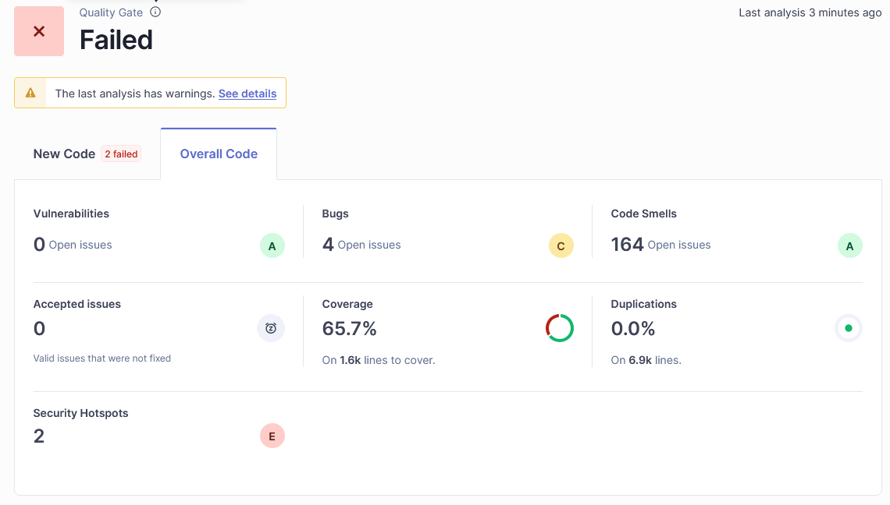
Podemos observar que en la pestaña de "New Code" se nos ofrece más información sobre el código que ha cambiado respecto al análisis anterior:
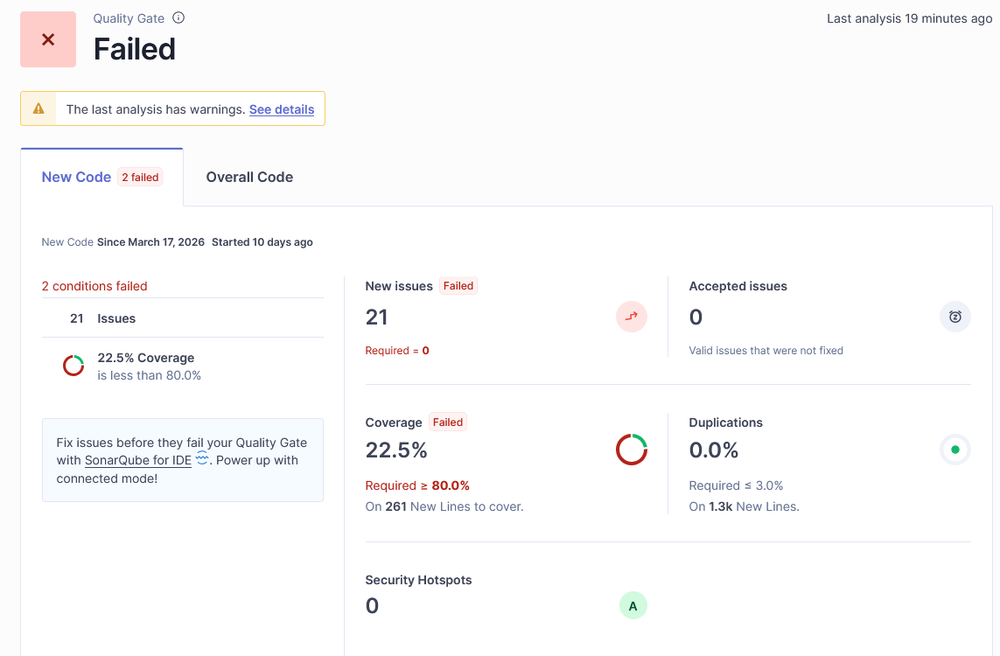 
En cuanto a las métricas del frontend, vemos el siguiente resumen.
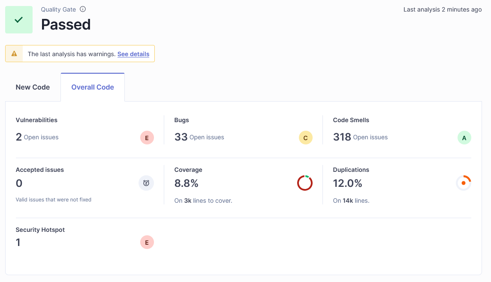
Con respecto al código nuevo del frontend, no se han detectado problemas nuevos significativos, como podemos observar en la siguiente imagen.
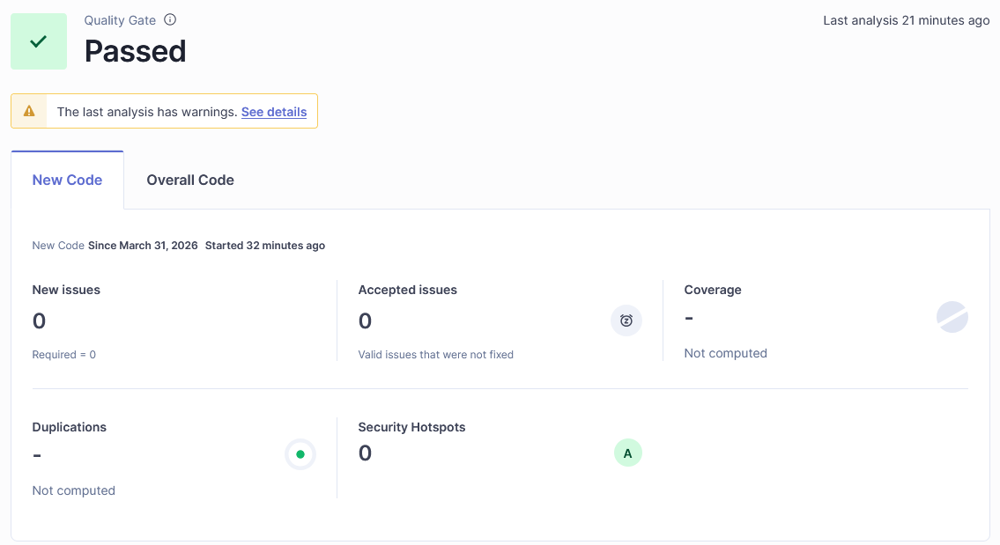
Estas nuevas métricas nos ofrecen más información sobre las nuevas aportaciones que se han realizado al proyecto.
### Nuevas métricas y su significado:
 * Conditions (Condiciones)
   - Descripción: Se tratan de las condiciones que no se han cumplido, y son las que definen nuestra "Quality Gate", es decir, si el análisis se considera fallido o no.
   - Valor obtenido en backend: 2 condiciones fallidas.
   - Interpretación: Con estas métricas SonarQube nos apunta a partes claras de las nuevas aportaciones que debemos mejorar para que no decaiga la calidad de nuestro proyecto.
 * Coverage (Cobertura de tests)
   - Descripción: Porcentaje del código nuevo que está cubierto por pruebas automatizadas.
   - Valor obtenido en backend: 22.5% (Se requiere al menos el 80% de cobertura)
   - Interpretación: No es una cobertura suficiente, si bien hay parte del nuevo código cubierto por tests se deben hacer nuevos tests y así asegurar el correcto funcionamiento de las nuevas funcionalidades antes de implementarlas a las ramas principales del proyecto.
 * New Issues (Nuevos problemas)
   - Descripción: Se trata de el número de nuevos Bugs, Vulnerabilidades y Code Smells que se introducen en el código nuevo.
   - Valor obtenido en backend: 21 (Se requieren 0)
   - Interpretación: Se han introducido nuevos factores a arreglar en el proyecto, con lo que hemos aumentado la deuda técnica. Idealmente deberíamos evitar esto por todos los medios posibles.
   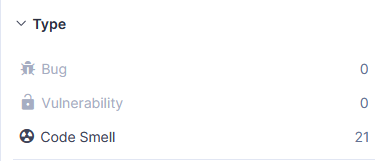
  Estos valores no son calculados en el análisis del frontend, por lo que no podemos compararlos directamente con el análisis anterior, aunque sí podremos comparar los datos derivados como haremos en la siguiente sección.

SonarQube nos ofrece información muy útil para permitirnos analizar no sólo el estado general del proyecto, sino sobre las nuevas aportaciones que se realizan al mismo. Ésto nos ayuda a mantener el nivel de calidad del proyecto dándonos métricas objetivas sobre la calidad de las nuevas aportaciones y los pasos a seguir para subirla en caso de que hayamos cometido errores.

## 2. Análisis de las métricas respecto al Sprint 1

Al brindarnos tanta información, este análisis nos permite hacer una comparación con los datos anteriores para hacernos una idea de cómo está evolucionando el proyecto más allá de las adiciones de nuevas funcionalidades. Así, podemos hacer un estudio con respecto a los datos del Sprint 1. Aunque varias de las métricas no han cambiado (no existe código duplicado, por ejemplo) encontramos 3 cambios con respecto al anterior Sprint que nos resultan muy significativos:
 * Quality Gate (Comprobación de calidad)
   - Descripción: No es más que una comprobación de si todas nuestras condiciones están siendo cumplidas.
   - Valores obtenidos en el backend: Passed -> Failed
   - Valores obtenidos en el frontend: Passed -> Passed
   - Interpretación: Aunque el valor del primer Sprint no era muy significativo al no haber datos anteriores (y por tanto no haber nuevas aportaciones al código), el que en el Sprint 2 haya pasado a ser fallida por las nuevas aportaciones nos sirve como aviso de que debemos mantener a rajatabla la calidad del código y tratar de evitar introducir nuevos problemas que contribuyan a la deuda técnica. 
 * Coverage (Cobertura de tests)
   - Descripción: Porcentaje del código del proyecto al completo que está cubierto por pruebas automatizadas.
   - Valores obtenidos en el backend: 75.2% -> 65.7% (-9.5% de cobertura)
   - Valores obtenidos en el frontend: 9.2% -> 8.8% (-0.4% de cobertura)
   - Interpretación: Este valor nos permite comprobar a primera vista que el nuevo código introducido al proyecto no está debidamente testado, y que no se han implementado nuevos tests para el código implementado en el Sprint anterior. Debemos dar más importancia en el futuro a mantener un buen nivel de cobertura.
 * Code Smells
   - Descripción: Como ya vimos anteriormente, es un indicativo de la mantenibilidad del código.
   - Valores obtenidos en el backend: 152 -> 164 (+12)
   - Valores obtenidos en el frontend: 308 -> 318 (+10)
   - Interpretación: Se han introducido nuevos code smells a la hora de hacer nuevas aportaciones al proyecto, lo cual aumentará la deuda técnica y se puede convertir en problemas más importantes si no le prestamos la atención debida.

## 3. Conclusiones del análisis del Sprint 2

El análisis con SonarQube nos ha permitido ver la importancia que tiene el mantener la calidad del código incluso en las nuevas aportaciones al proyecto. Además, nos da la información necesaria para tomar decisiones sobre oportunidades de mejora que debemos tomar en el futuro: 
   * Asegurar la cobertura de tests sobre el código nuevo para evitar deuda técnica acumulada.
   * Tener cuidado y estudiar (y corregir) los code smells que ya se encuentran en el proyecto conforme se realizan avances en el mismo para aprender a evitar generar nuevos code smells con el tiempo.


# 3. Conclusiones de la comparación de Sprints
La comparación entre S1 y S2 muestra la evolución del proyecto y nos permite darnos cuenta de que debemos tener mucho cuidado a la hora de realizar nuevas aportaciones. Como líneas futuras de mejora se proponen:
   * Integrar SonarQube para el grupo como herramienta de estudio del código del proyecto para mejorar el nuevo código generado
   * Aumentar la cobertura de tests
   * Corregir code smells, bugs y puntos clave de seguridad paulatinamente para abordar la deuda técnica del proyecto.
En conclusión, el uso de herramientas de análisis de proyecto como SonarQube nos ha resultado de tremenda utilidad para aprender los factores que nos permitirán mantener un código limpio, legible y mantenible a largo plazo.

---
<div align="center">
  <sub>ASIGNATURA: PROCESO SOFTWARE Y GESTIÓN II | CURSO: 2025/2026 | GRUPO: G6-63 PETCLINIC | REPOSITORIO: HTTPS://GITHUB.COM/GII-IS-PSG2/PSG2-2526-G6-63</sub>
</div>