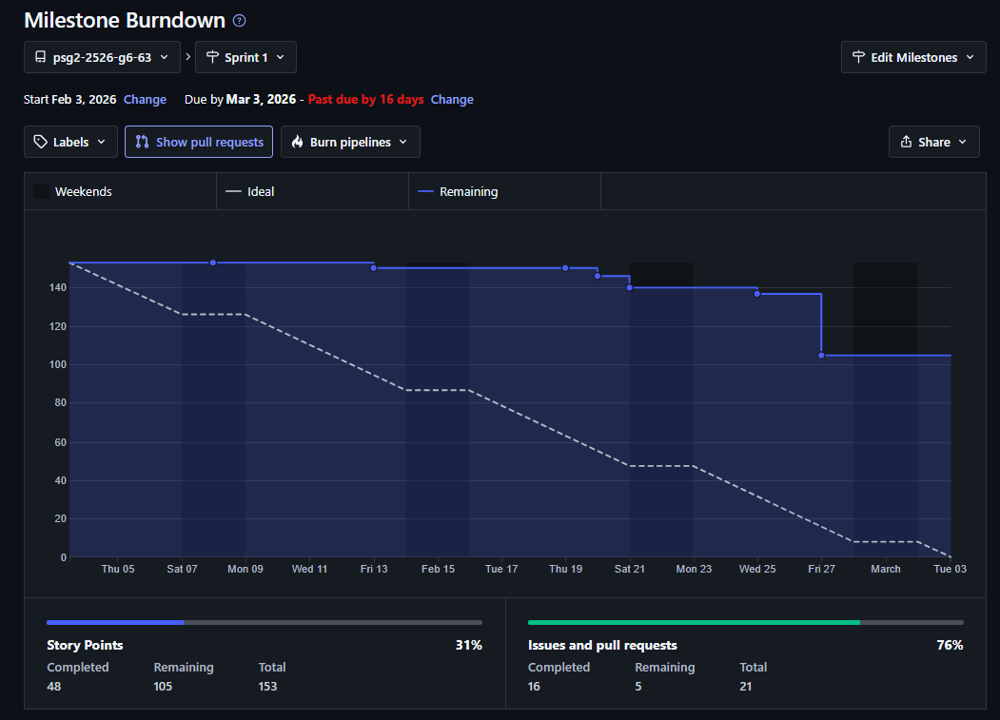
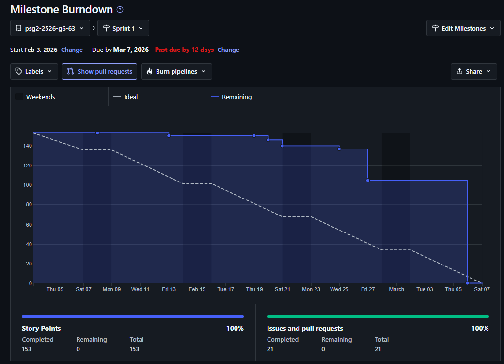
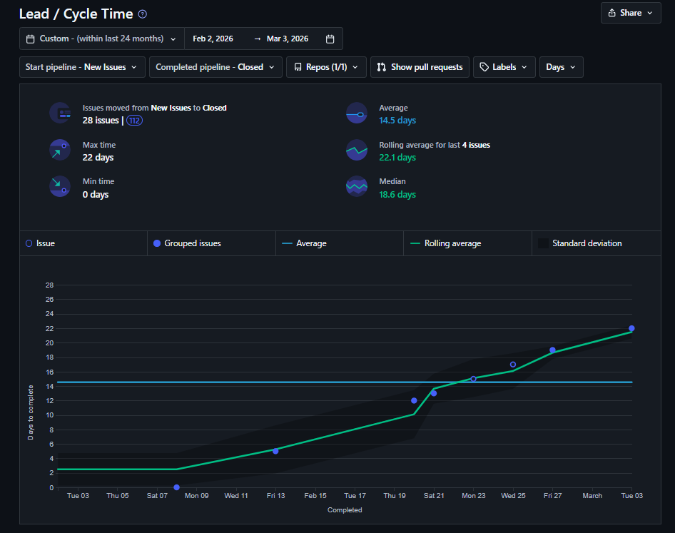
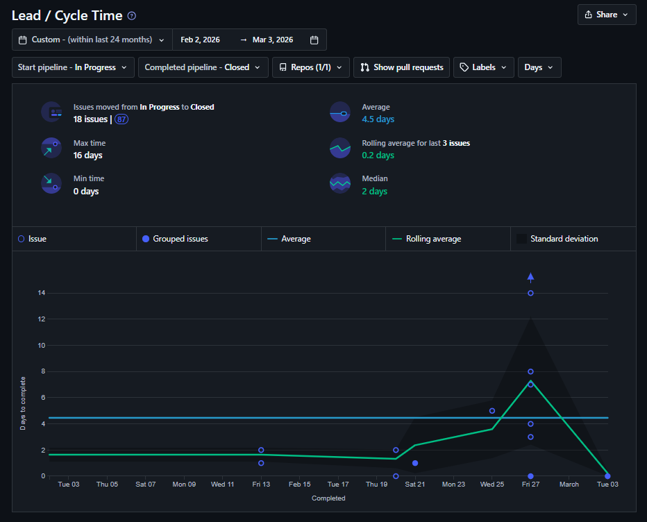
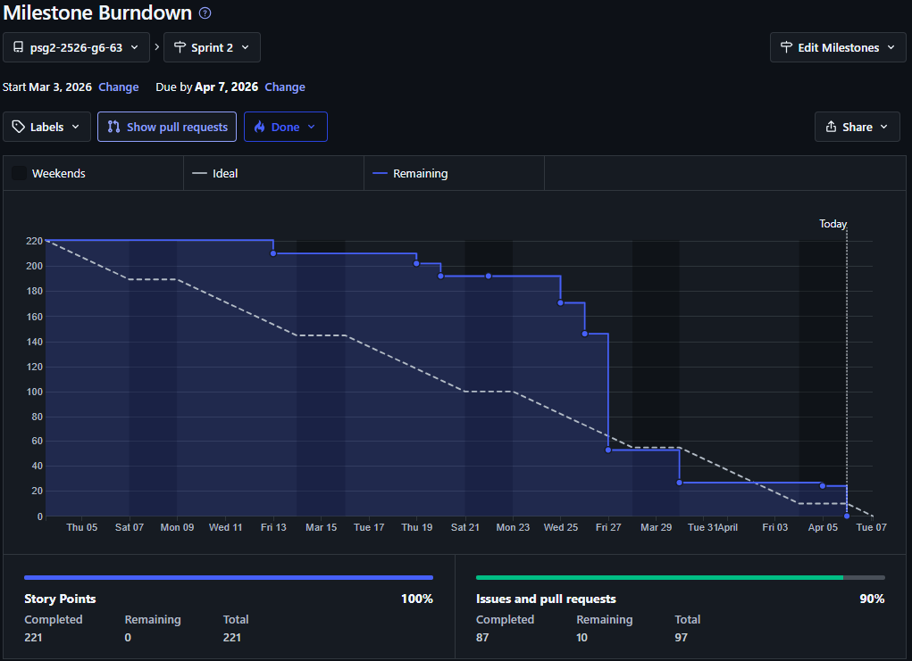
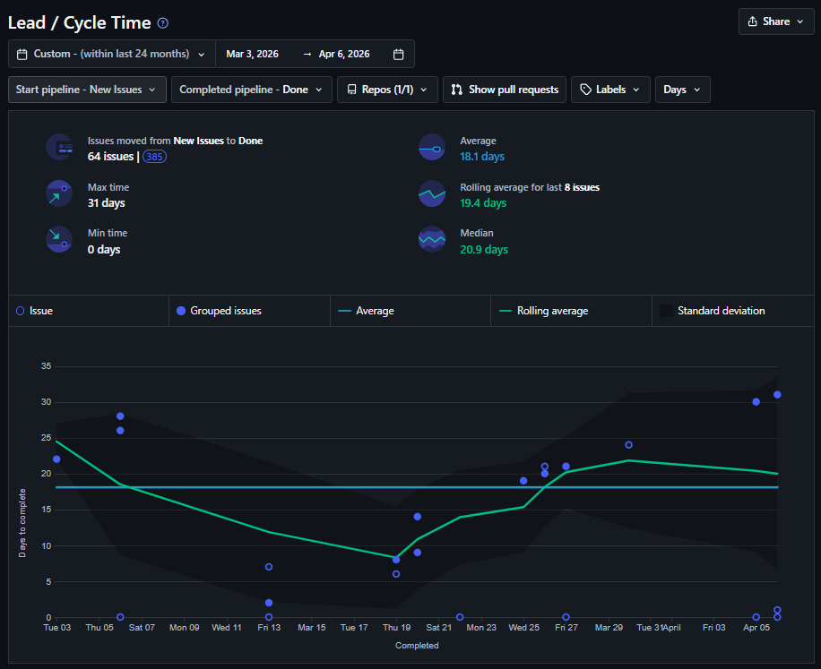
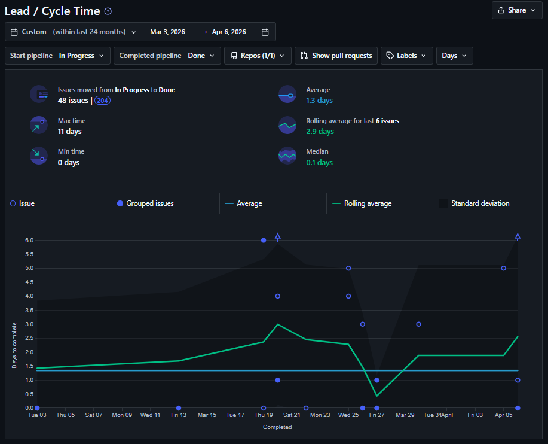
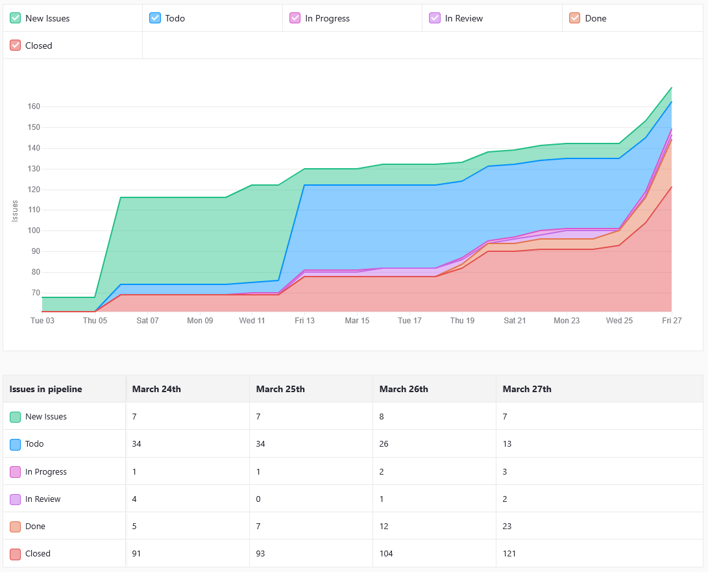

     
   <h1>Métricas de Proceso Ágil y Recursos</h1>
    
   
     
   

      <strong>ASIGNATURA:</strong> PROCESO SOFTWARE Y GESTIÓN II 
      <strong>2025/2026</strong>  
      <strong>G6-63</strong> PETCLINIC 
      <strong>REPOSITORIO:</strong> HTTPS://GITHUB.COM/GII-IS-PSG2/PSG2-2526-G6-63
   

 

   <h3>Equipo de Desarrollo</h3>
   Pablo Reche Gabaldón 
   Diego Vicente Cámara 
   Ignacio Fuertes Montero 
   Mario Domínguez López 
   Diego José Rodríguez Fernández

 

| Versión | Fecha de modificación | Autor | Descripción del cambio |
|---------|-----------------------|-------|------------------------|
| 1.0 | 01/04/2026 | Mario D.L. | Creación del documento y análisis Sprint 1 |
| 1.1 | 03/04/2026 | Mario D.L. | Añadido análisis Sprint 2 |
| 1.2 | 05/04/2026 | Mario D.L. | Métricas avanzadas y calendario Niko-Niko |
| 1.3 | 06/04/2026 | Mario D.L. | Correcciones y mejoras en el análisis |

## Índice

1. [Análisis S1: Burn Down Chart](#1-análisis-de-sprint-s1-milestone-burn-down-chart)
2. [Análisis S1: Lead Time](#2-análisis-de-sprint-s1-chart-showing-lead-time)
3. [Análisis S1: Cycle Time](#3-análisis-de-sprint-s1-chart-showing-cycle-time)
4. [Análisis S1: Total Points Delivered](#4-análisis-de-sprint-s1-total-history-points-delivered)
5. [Análisis S1: Percentage Points Delivered](#5-análisis-de-sprint-s1-percentage-of-history-points-delivered)
6. [Análisis S1: Bottleneck Tracking](#6-análisis-de-sprint-s1-bottleneck-tracking-chart)
7. [Análisis S2: Burn Down Chart](#7-análisis-de-sprint-s2-milestone-burn-down-chart)
8. [Análisis S2: Lead Time](#8-análisis-de-sprint-s2-chart-showing-lead-time)
9. [Análisis S1: Cycle Time](#9-análisis-de-sprint-s1-chart-showing-cycle-time)
10. [Total History Points Delivered](#10-total-history-points-delivered)
11. [Percentage of History Points Delivered](#11-percentage-of-history-points-delivered)
12. [Análisis S2: Bottleneck Tracking](#12-análisis-de-sprint-s2-bottleneck-tracking-chart)
13. [Análisis cuantitativo S2](#13-análisis-cuantitativo-del-sprint-2)
14. [Análisis cualitativo Niko-Niko](#14-analisis-cualitativo-del-calendario-niko-niko)

# Métricas de Proceso Ágil y Recursos

## 1. Análisis de Sprint S1: Milestone Burn Down Chart

Para analizar el desempeño del equipo durante el primer Sprint (S1), hemos utilizado el framework GQM, esto lo hacemos con el objetivo de mejorar nuestra capacidad de entrega :

### 1.1. Visualización de la Métrica

A continuación, se presentan dos capturas del Burndown Chart de ZenHub para el Sprint 1.

#### Escenario A: Fechas oficiales del Sprint
En esta gráfica se observa que, al llegar a la fecha límite (3 de marzo), parece que el equipo solo completó el *31%* de los Story Points (48 de 153), esto se debe a que asignamos puntos de historia a las épicas, error que debemos solventar en el siguiente Sprint.

#### Escenario B: Ajuste por desfase administrativo
Al extender el rango de visualización hasta el 7 de marzo, se observa que el *100%* de los puntos (153) fueron completados porque cerramos las épicas más tarde aunque ya estuvieran completadas.

### 1.2. Análisis Crítico y Lecciones Aprendidas

Aunque el trabajo técnico se finalizó dentro de los plazos del Sprint, la métrica oficial muestra una desviación significativa. Esto se debe a un error en la gestión de estados en ZenHub:

1.  *Desfase en la actualización:* El equipo completó las tareas, pero no movió las épicas y las issues a la columna de Done  hasta después de la fecha de cierre.
2.  *Impacto en la predictibilidad:* Como se menciona en la teoría sobre el "Cobra Effect" y la Ley de Goodhart, una métrica que no refleja la realidad pierde su valor como herramienta de toma de decisiones. En este caso, el gráfico muestra un "ritmo de entrega" nulo durante semanas, seguido de una caída vertical masiva al final.
3.  *Acción correctiva para S2:* * Establecer una política de actualización más estricta en ZenHub. Además no asignaremos puntos de historia a las épicas.

## 2. Análisis de Sprint S1: Chart showing Lead Time
Para medir cuánto tiempo transcurre desde que surge una issue hasta que se cierra definitivamente, hemos configurado el Control Chart para analizar el Lead Time con el pipeline de "New Issues" hasta "Done".

### 2.1. Visualización de la Métrica

### 2.2. Análisis del Desarrollo y Problemas Detectados
Los datos muestran un Lead Time medio de 14.5 días. Sin embargo, la gráfica revela una realidad más compleja sobre nuestra adaptación al proceso:

1. *Curva de aprendizaje y adaptación:* Al ser nuestro primer contacto real con la metodología, se observa una tendencia ascendente en la media móvil (línea verde), que termina el sprint en 22.1 días. Esto refleja lo que nos costó interiorizar los flujos de trabajo al principio.

2. *El cuello de botella de las revisiones:* Un factor crítico fue el tiempo que las tareas permanecieron en la columna de revisión. Aunque el trabajo técnico estaba terminado, la dependencia de la disponibilidad de un compañero para validar el código alargó artificialmente el tiempo de vida de los issues.

3. *Falta de flujo continuo:* El hueco visible entre el 13 y el 20 de febrero indica un periodo donde no se cerró nada. Esto no significa que no trabajáramos, sino que acumulamos demasiadas tareas en revisión sin llegar a darles el cierre final.

## 3. Análisis de Sprint S1: Chart showing Cycle Time
Para medir la eficiencia de nuestro flujo de trabajo una vez que el equipo comienza la ejecución técnica, hemos configurado el Control Chart para analizar el Cycle Time, tomando como referencia el tiempo transcurrido desde que una issue entra en el pipeline de "In Progress" hasta que se marca como "Done".

### 3.1. Visualización de la Métrica

### 3.2. Análisis del Desempeño y Problemas Detectados
Los datos registrados muestran un Cycle Time medio de 4.5 días. No obstante, el comportamiento de la gráfica refleja las mismas dificultades de adaptación mencionadas anteriormente:

1. *Inestabilidad y falta de predictibilidad:* Se observa una gran dispersión en los tiempos de finalización, con tareas cerradas en 0 días y un valor máximo de 16 días. La presencia de múltiples outliers (puntos fuera del área gris) el 27 de febrero indica que nuestro proceso estuvo "fuera de control" y fue poco predecible en la fase final del sprint.

2. *Impacto del cuello de botella en revisiones:* El marcado pico en la media móvil (línea verde) hacia finales de febrero evidencia cómo el tiempo de ciclo aumentó debido al estancamiento de tareas en la fase de revisión. Aunque el desarrollo técnico avanzaba, la dependencia de la validación externa impidió cierres ágiles, acumulando el trabajo finalizado.

3. *Irregularidad en el flujo de trabajo:* Se identifica un periodo de estancamiento o hueco entre el 13 y el 20 de febrero donde no hubo movimiento hacia el estado cerrado de tareas que ya estaban en progreso. Esto confirma que, en este primer contacto con la metodología, no logramos mantener un ritmo de entrega constante, concentrando los resultados en la última semana del sprint.

## 4. Análisis de Sprint S1: Total History Points Delivered

Para analizar la cantidad total de trabajo entregado durante el Sprint 1, hemos utilizado el *Burndown Chart* de ZenHub, centrándonos en los *story points* completados al finalizar el sprint.

### 4.1. Análisis del Resultado

Durante el Sprint 1 se entregaron un total de **153 story points**, alcanzando el **100% del trabajo comprometido**.

Sin embargo, el gráfico revela que este resultado no se produjo de manera progresiva:

1. *Entrega concentrada al final del Sprint:*  
   La línea de trabajo restante (Remaining) se mantiene prácticamente constante durante la mayor parte del sprint, indicando que no se estaban cerrando issues de forma continua. La caída abrupta hasta 0 al final muestra que la mayoría de los puntos se completaron en un único momento.

2. *Desfase entre trabajo realizado y registrado:*  
   Aunque el equipo estaba trabajando activamente, los puntos no se reflejaban como entregados en la herramienta hasta el cierre final. Esto provoca que la métrica de puntos entregados no represente fielmente el progreso real del equipo durante el sprint.

3. *Limitación de la métrica como indicador de rendimiento:*  
   El valor total (153 puntos) sugiere una alta capacidad de entrega, pero al no existir un flujo continuo de cierre, esta cifra pierde valor para evaluar la eficiencia del proceso y dificulta su uso para estimaciones futuras.

### 4.2. Conclusión

El equipo logró completar el 100% de los *story points* comprometidos en el Sprint 1, pero la entrega se realizó de forma acumulada al final del sprint. Para que la métrica de *Total History Points Delivered* sea realmente útil, es necesario acompañarla de un cierre progresivo de tareas que refleje el avance real del trabajo.

## 5. Análisis de Sprint S1: Percentage of History Points Delivered

Para analizar el porcentaje de trabajo completado durante el Sprint 1, hemos utilizado el *Burndown Chart* de ZenHub, observando la relación entre los *story points* totales y los puntos completados al cierre del sprint.

### 5.1. Análisis del Resultado

Al finalizar el Sprint 1, se alcanzó un **100% de story points completados** (153 de 153), lo que indica que todo el trabajo comprometido fue finalmente entregado.

Sin embargo, el análisis del gráfico muestra que este porcentaje no refleja adecuadamente el desarrollo real del sprint:

1. *Progreso no representativo durante el sprint:*  
   A lo largo de la mayor parte del sprint, el porcentaje de puntos entregados se mantuvo prácticamente en **0%**, ya que no se registraban cierres de issues. Esto sugiere una falta de visibilidad del progreso real.

2. *Incremento abrupto del porcentaje:*  
   El paso de 0% a 100% ocurre de forma repentina al final del sprint, lo que indica que los cierres de tareas se realizaron de manera acumulada y no progresiva.

3. *Desfase en la interpretación del rendimiento:*  
   Aunque el resultado final es óptimo (100%), el comportamiento del porcentaje durante el sprint puede llevar a interpretaciones erróneas, como una aparente falta de avance durante la mayor parte del tiempo.

### 5.2. Conclusión

El Sprint 1 alcanza un **100% de puntos entregados**, pero la evolución de esta métrica evidencia una gestión ineficiente del cierre de tareas. Para que el *Percentage of History Points Delivered* sea un indicador fiable, es necesario reflejar el progreso de forma continua a lo largo del sprint, evitando concentrar los cierres en su fase final.

## 6. Análisis de Sprint S1: Bottleneck Tracking Chart

Para identificar posibles cuellos de botella en el flujo de trabajo durante el Sprint 1, hemos utilizado el *Bottleneck Tracking* de ZenHub, que muestra la evolución de las issues a través de las distintas columnas del pipeline.

### 6.1. Análisis del Flujo de Trabajo

El gráfico refleja cómo se distribuye el trabajo pendiente y completado a lo largo del sprint:

1. *Acumulación de trabajo pendiente (Todo):*  
   Se observa un volumen elevado de issues en la columna **Todo** durante gran parte del sprint, alcanzando valores superiores a 20 tareas. Este comportamiento es esperable especialmente al inicio del sprint, ya que durante el *Sprint Planning* se definen y asignan todas las tareas a realizar.  
   
   Sin embargo, el hecho de que este volumen se mantenga alto durante varios días indica que el trabajo no se fue activando de forma progresiva, retrasando el paso de tareas a ejecución.

2. *Flujo controlado en ejecución (In Progress):*  
   La columna **In Progress** presenta valores bajos y estables a lo largo del sprint. Este comportamiento es coherente con una buena práctica en metodologías ágiles: cada miembro del equipo trabaja en una única tarea a la vez.  
   
   Dado que el equipo está formado por 5 integrantes, el número máximo razonable de tareas simultáneamente en progreso sería 5. El hecho de que los valores observados estén por debajo de este límite indica que no hubo sobrecarga de trabajo en ejecución y que se evitó la multitarea excesiva.

3. *Escasa actividad en revisión (In Review):*  
   La fase de revisión prácticamente no muestra acumulación, lo que sugiere que esta etapa no fue un punto de congestión, sino más bien una fase poco utilizada o muy breve.

4. *Cierre tardío de tareas:*  
   La mayor parte de las issues pasan a estado **Closed** en los últimos días del sprint, acompañado de una caída brusca en las demás columnas. Esto confirma que las tareas no se cerraban de forma progresiva.

### 6.2. Identificación del Bottleneck

El principal cuello de botella no se encuentra en una fase intermedia específica, sino en la **gestión del flujo de cierre**, ya que:

- Las tareas permanecen en estados no finales durante la mayor parte del sprint.
- No hay un flujo continuo hacia el cierre.
- Se produce una acumulación que se libera únicamente al final.

### 6.3. Impacto en el Proceso

- *Falta de visibilidad del progreso real:* El trabajo realizado no se refleja en el sistema hasta el final.
- *Riesgo de sobrecarga final:* La concentración de cierres aumenta la presión en los últimos días.
- *Pérdida de control del flujo:* No se mantiene un ritmo estable de avance entre estados.

### 6.4. Acciones de Mejora para S2

- Reducir el volumen de tareas en **Todo**, priorizando mejor el trabajo del sprint.
- Fomentar un flujo continuo de paso a **In Progress**.
- Establecer cierres frecuentes en lugar de acumulados.
- Revisar periódicamente el estado de las tareas para evitar bloqueos invisibles.

## 7. Análisis de Sprint S2: Milestone Burn Down Chart

Para analizar el desempeño del equipo durante el primer Sprint (S2), hemos utilizado el framework GQM, esto lo hacemos con el objetivo de mejorar nuestra capacidad de entrega :

### 7.1. Visualización de la Métrica

### 7.2. Análisis Crítico y Lecciones Aprendidas

A diferencia de la experiencia en el Sprint 1, los datos actuales reflejan una gestión más activa de las tareas, aunque todavía enfrentamos retos en el flujo de trabajo.El análisis de la línea de trabajo restante frente a la línea Ideal revela un desarrollo marcado por factores externos y organizativos:

- *Etapa 1 Parón por Incidencias (3 - 13 marzo):* La gráfica se mantiene plana al inicio. Este estancamiento real se debió a la semana de trabajo intensivo en las incidencias asignadas, lo que impidió avanzar en los puntos de historia del backlog.

- *Etapa 2 Confusión Metodológica:* Tras retomar el ritmo, el avance fue lento debido a la confusión del equipo con las buenas prácticas y estándares exigidos, lo que retrasó el cierre de las primeras tareas.

- *Etapa 3 Impacto de Exámenes Externos:* Se observa una nueva meseta a finales de marzo. Este retraso fue causado por factores externos, específicamente la carga de exámenes de otras asignaturas de los miembros del grupo.

- *Etapa 4 Avance Constante y Cierre:* Finalmente, se aprecia una caída vertical pronunciada. El equipo logró una dinámica de trabajo más constante al final, cerrando los 221 Story Points comprometidos (100% de éxito en entrega de valor).

### 7.3 Comparativa y Conclusión de Valor
El equipo ha logrado una mejora sustancial en la disciplina de reporte en ZenHub. 

*Lección aprendida:* La visibilidad del progreso ha sido mucho más granular que en el Sprint 1. Hemos pasado de un modelo de caída única al final del sprint a un modelo de "cierres escalonados" que, a pesar de las interrupciones por incidencias y exámenes, refleja mejor la realidad del trabajo realizado y mejora nuestra predictibilidad de cara a futuros ciclos.

## 8. Análisis de Sprint S2: Chart showing Lead Time
Para medir cuánto tiempo transcurre desde que surge una issue hasta que se cierra definitivamente, hemos configurado el Control Chart para analizar el Lead Time con el pipeline de "New Issues" hasta "Done".

### 8.1. Visualización de la Métrica

### 8.2. Análisis del Desarrollo y Problemas Detectados
El análisis de los datos finales debe interpretarse bajo el prisma de la estructura del sprint, diferenciando el trabajo técnico de las obligaciones administrativas:

1. *Interpretación del Promedio (18.1 días):* Aunque el Lead Time medio ha subido a 18.1 días, este valor está fuertemente condicionado por las tareas obligatorias de final de sprint. Issues como la "Retrospectiva" o la "Review", creadas al inicio del periodo y cerradas el último día, arrastran automáticamente un Lead Time muy elevado. Esto explica por qué la mediana (20.9 días) es tan alta: no es que el equipo sea lento, sino que gran parte del volumen de issues está vinculado al cierre oficial del sprint.

2. *Análisis de los Outliers Estructurales (Puntos desviados drásticamente):* Los puntos situados en la parte superior de la gráfica (cercanos a los 28 días) representan esas tareas de gestión que deben permanecer abiertas por obligación. Estos no deben considerarse fallos de eficiencia, sino "tiempos muertos obligatorios" inherentes a la metodología. Por el contrario, los puntos cercanos al eje inferior muestran que las peticiones técnicas puras se están atendiendo con mucha mayor rapidez.

3. *Tendencia de la Media Móvil:* La media móvil (línea verde) refleja un comportamiento fluctuante que termina en 19.4 días. Tras una mejora notable a mitad de mes, se observa un ascenso final provocado por el cierre acumulado de tareas que se retrasaron debido a la semana de exámenes y a la finalización obligatoria de tareas de gestión como la Review y Retrospectiva.

4. *Conclusión:* El volumen de issues cerrados es un indicador de éxito en la capacidad de resolución del equipo. Si aislamos las tareas de "ceremonia" que inflan la media, el proceso es mucho más eficiente de lo que indica el valor bruto de 18.1 días.

## 9. Análisis de Sprint S2: Chart showing Cycle Time
Para medir la eficiencia de nuestro flujo de trabajo una vez que el equipo comienza la ejecución técnica, hemos configurado el Control Chart para analizar el Cycle Time, tomando como referencia el tiempo transcurrido desde que una issue entra en el pipeline de "In Progress" hasta que se marca como "Done".

### 9.1. Visualización de la Métrica

### 9.2. Análisis del Desempeño y Problemas Detectados
El análisis de los datos finales del Sprint 2 consolida la tendencia de mejora en la capacidad de entrega técnica, permitiendo extraer las siguientes conclusiones:

1. *Optimización de los tiempos de desarrollo:* El Cycle Time medio se ha estabilizado en 1.3 días. Esta cifra, sumada a una mediana de 0.1 días, confirma que el equipo mantiene un estado de alta agilidad: una vez que se inicia el trabajo técnico, la gran mayoría de las tareas se completan de forma casi inmediata.

2. *Incremento sostenido del rendimiento (Throughput):* En el cierre de este sprint hemos logrado finalizar 48 issues. Esto supone un incremento muy notable respecto a las 18 tareas cerradas en el Sprint 1, multiplicando por 2.6 nuestra capacidad de entrega final. Este volumen de trabajo confirma que el equipo ha interiorizado con éxito la metodología.

3. *Gestión eficiente de tareas complejas:* El tiempo máximo dedicado a un issue ha sido de 11 días. Aunque es superior a lo visto a mitad del ciclo, sigue estando por debajo de los 16 días registrados en el Sprint 1, lo que demuestra una mejor capacidad para gestionar bloqueos y evitar que tareas complejas se estanquen indefinidamente.

4. *Persistencia de irregularidades en el flujo:* A pesar de los excelentes números, la gráfica muestra que todavía arrastramos vicios organizativos. Persiste un periodo de estancamiento inicial entre el 3 y el 13 de marzo. Siendo realistas, este vacío se debió a que la primera semana se dedicó íntegramente a la planificación y la posterior a la resolución de incidencias críticas, lo que impidió un flujo de entrega constante de nuevas funcionalidades desde el inicio.

5. *Conclusión:* La mejora en el Cycle Time es sobresaliente, situando al equipo en un nivel de eficiencia técnica muy alto con una media final de 1.3 días. El aprendizaje extraído es que factores externos y de planificación siguen concentrando el grueso de los cierres en la segunda mitad del sprint, lo que eleva la tendencia de la media móvil al final hasta los 2.9 días. El objetivo para el próximo ciclo debe ser suavizar estas etapas iniciales para lograr un flujo de valor más equilibrado.

## 10.Total History Points Delivered

Para analizar la cantidad total de trabajo entregado durante el Sprint 2, hemos utilizado el *Burndown Chart* de ZenHub, centrándonos en los *story points* completados hasta el momento actual del sprint.

### Análisis del Resultado

En el Sprint 2 se han completado un total de **221 story points**, alcanzando la totalidad del trabajo comprometido.

A diferencia del Sprint 1, se observa una mejora clara en la forma de entrega:

1. *Entrega progresiva durante el sprint:*  
   La línea de trabajo restante muestra descensos escalonados a lo largo del sprint, lo que indica que los puntos se han ido cerrando de forma continua, evitando la acumulación total al final.

2. *Mejor alineación entre trabajo real y registrado:*  
   Los puntos entregados reflejan de forma más fiel el progreso del equipo, lo que indica una mejora en la actualización de estados en ZenHub.

3. *Capacidad de cumplimiento del compromiso:*  
   El equipo ha sido capaz de completar todos los puntos planificados dentro del sprint, lo que indica una mejora en la planificación y ejecución respecto a iteraciones anteriores.

### Conclusión

El Sprint 2 muestra una evolución positiva tanto en el volumen de trabajo entregado como en la forma en la que se ha distribuido durante el sprint. La entrega completa de los *story points* junto con un flujo progresivo indica una mejora significativa en la madurez del proceso ágil del equipo.

## 11. Percentage of History Points Delivered

Para analizar el porcentaje de trabajo completado durante el Sprint 2, hemos utilizado el *Burndown Chart* de ZenHub, observando la relación entre los *story points* totales y los puntos completados.

### Análisis del Resultado

En el Sprint 2 se ha alcanzado un **100% de story points completados** (221 de 221).

Este resultado refleja una mejora significativa respecto al Sprint 1:

1. *Progreso continuo a lo largo del sprint:*  
   A diferencia del Sprint 1, donde el porcentaje permanecía cercano a 0% durante gran parte del tiempo, en este sprint el avance ha sido progresivo y visible.

2. *Mayor transparencia del proceso:*  
   El incremento gradual del porcentaje indica que las tareas se han ido cerrando de forma continua, lo que permite un mejor seguimiento del progreso del equipo.

3. *Cumplimiento del objetivo del sprint:*  
   Alcanzar el 100% de los puntos comprometidos confirma que la planificación del sprint ha sido adecuada y que el equipo ha sido capaz de ejecutar el trabajo dentro del tiempo previsto.

### Conclusión

El Sprint 2 alcanza el **100% de puntos entregados** con un patrón de progreso continuo, lo que representa una mejora clara tanto en la ejecución como en la visibilidad del trabajo respecto al Sprint 1. Este comportamiento está alineado con las buenas prácticas ágiles y refuerza la capacidad del equipo para planificar y cumplir sus objetivos.

## 12. Análisis de Sprint S2: Bottleneck Tracking Chart

De la misma manera que en el Sprint 1, hemos utilizado las funcionalidades de ZenHub para hacer un análisis del Bottleneck del desarrollo del proyecto:

### 12.1 Evolución general del flujo de trabajo

En la gráfica se ve un incremento progresivo, pero más acentuado a partir del día 18 de Marzo y de nuevo desde el día 26 de Marzo. Esto nos indica que abordamos contínuamente nuevas tareas, y el incremento de la gráfica de new issues nos da una medidaa del aumento del alcance del proyecto a lo largo del Sprint debido a la detección de nuevas subissues.
Viendo el avance de los estados finales, podemos apreciar un avance progresivo y adecuado, si bien desviado hacia el final del periodo. 

El principal cuello de botella no se encuentra en una fase intermedia específica, sino en la acumulación de tareas en Todo y en la falta de transición de Todo a In Progress, lo que nos indica que hemos trabajado en pocas tareas simultáneamente y que puede hacer falta una revisión de la estrategia del trabajo en equipo.

### 12.2 Análisis con respecto al Sprint 1

Podemos apreciar que de los problemas que nos encontramos en el Sprint 1 hemos conseguido abordar satisfactoriamente la gran mayoría, encontrando una mejora considerable del proceso. Sobre todo vemos que el flujo desde In Progress a los estados finales ha sido mejorado significativamente, y que el cuello de botella que existía anteriormente en esa parte del proceso ha mejorado mucho.
Además, podemos observar que el correcto seguimiento de la metodología de trabajo con respecto al Sprint 1 nos ha ayudado a tener un Bottleneck Chart mejor estructurado y fácilmente legible. Los errores que cometimos en el Sprint anterior nos han ayudado a comprender la importancia de seguir estrictamente estas metodologías, y nos han enseñado los procedimientos correctos a seguir con respecto al desarrollo de proyectos de este calibre.

### 12.3 Acciones de Mejora para S3

- Reducir aún más el volumen de tareas en **Todo**, priorizando mejor el trabajo a través sprint mediante una mejor distribución inicial del trabajo.
- Fomentar un flujo continuo de paso desde **New Issues** a **Todo**.
- Mantener el ritmo de revisión y cierre de issues actual para fomentar un ciclo de desarrollo ágil.

## 13. Análisis cuantitativo del sprint 2

Se han analizado los 75 registros del calendario Niko-Niko del sprint 2, considerando los 15 días del sprint y los 5 integrantes del equipo.

### 13.1. Moda global

La moda global del sprint es un empate entre 😄 y -, con 30 apariciones cada uno.

Esto indica que el sprint alternó de forma muy equilibrada entre días con valoración positiva y días sin actividad registrada.

### 13.2. Moda semanal

| Semana | Días | Moda | Frecuencia |
| ------ | ---- | ---- | ---------- |
| Semana 1 | Días 1-5 | 😄 | 14 |
| Semana 2 | Días 6-10 | - | 14 |
| Semana 3 | Días 11-15 | 😄 | 10 |

### 13.3. Moda por desarrollador y semana

| Desarrollador | Semana 1 | Semana 2 | Semana 3 |
| ------------- | -------- | -------- | -------- |
| Diego José | 😄 / - (2) | 😄 (3) | 😄 (2) |
| Mario Domínguez | 😄 / - (2) | - (3) | 😄 (2) |
| Ignacio Fuertes | 😄 (4) | - (4) | 😄 (3) |
| Pablo Reche | 😄 (3) | - (3) | 😄 (2) |
| Diego Vicente | 😄 (3) | 😄 (3) | - (3) |

## 14 Analisis cualitativo del calendario Niko-Niko

El análisis cualitativo complementa las modas del punto anterior y permite interpretar mejor qué está ocurriendo en la dinámica del equipo.

### 14.1. Conclusiones

1. *Inicio del sprint con buena energía:* La primera semana presenta predominio de estados positivos (😄), lo que sugiere buena motivación inicial y sensación de control sobre las tareas.

2. *Desaceleración en la semana intermedia:* En la segunda semana aumentan claramente los guiones (-), indicando días sin trabajo registrado en el proyecto o menor continuidad de dedicación.

3. *Picos de tensión al final del sprint:* En la tercera semana aparecen estados de mayor malestar (😟, 😫, 😐), especialmente alrededor de los días 11 y 13, lo que apunta a presión acumulada por cierres, bloqueos o carga concentrada a la que también se le suman ciertas entregas y exámenes que hemos tenido.

4. *Comportamiento heterogéneo entre miembros:* Aunque varios integrantes mantienen una tendencia positiva, no todos viven el sprint igual; algunos muestran más oscilaciones emocionales, por lo que la gestión de la carga debe ser más personalizada.

5. *Problema principal de proceso más que de actitud:* La combinación de muchos guiones con picos de estrés sugiere que el riesgo está en la organización del flujo (ritmo, reparto y cierre) más que en una falta general de compromiso del equipo.

### 14.2. Posibles acciones para mejorar la moral del equipo

1. *Redistribución dinámica de tareas en mitad de sprint:* Revisar carga a mitad de cada semana para evitar que la presión se concentre siempre en las mismas personas o en los últimos días.

2. *Límite de trabajo en paralelo y cierre progresivo:* Reducir tareas abiertas simultáneamente y priorizar terminar antes de empezar nuevas, para evitar acumulación final y sensación de descontrol.

3. *Parejas de apoyo en días de alerta:* Cuando aparezcan 😟 o 😫, activar acompañamiento puntual (pair programming o revisión asistida) para desbloquear más rápido.

4. *Objetivo explícito de estabilidad emocional semanal:* Definir como meta reducir símbolos negativos y aumentar continuidad de registros (menos guiones por ausencia de seguimiento).

### 14.3. Cierre

El calendario Niko-Niko muestra que la moral del equipo es generalmente positiva, pero vulnerable a la acumulación de trabajo en la parte final del sprint. Si se refuerza el seguimiento intermedio, la redistribución de carga y el apoyo temprano ante señales de estrés, es esperable mejorar tanto el bienestar del equipo como la consistencia del rendimiento.

---

  ASIGNATURA: PROCESO SOFTWARE Y GESTIÓN II | CURSO: 2025/2026 | GRUPO: G6-63 PETCLINIC | REPOSITORIO: HTTPS://GITHUB.COM/GII-IS-PSG2/PSG2-2526-G6-63

