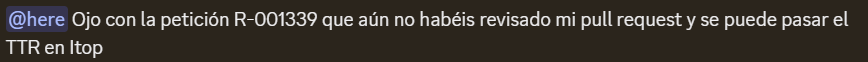

     
   <h1>Monitorización del Acuerdo de Cliente de PetClinic Services (PSG2-2526-G6-63)</h1>
    
   
     
   

      <strong>ASIGNATURA:</strong> PROCESO SOFTWARE Y GESTIÓN II 
      <strong>2025/2026</strong>  
      <strong>G6-63</strong> PETCLINIC 
      <strong>REPOSITORIO:</strong> HTTPS://GITHUB.COM/GII-IS-PSG2/PSG2-2526-G6-63
   

 

   <h3>Equipo de Desarrollo</h3>
   Pablo Reche Gabaldón 
   Diego Vicente Cámara 
   Ignacio Fuertes Montero 
   Mario Domínguez López 
   Diego José Rodríguez Fernández

 

## Historial de Versiones

| Versión | Fecha de modificación | Autor | Descripción del cambio |
|---------|-----------------------|-------|------------------------|
|    1.0     |  13/04/2026  | Mario D.L.  | Creación del documento, clasificación incidentes y análisis de los valores originales del SLT  |
|    2.0     |  08/05/2026  | Diego V.C.  | Estrategia para asegurar el cumplimiento del CA  |
|    3.0     |  08/05/2026  | Diego V.C.  |  Clasificación de incidentes |
|    4.0     |  09/05/2026  | Diego José R.F.  | Clasificación incidentes  |
|    5.0     |  09/05/2026  | Diego José R.F.  | Elementos adicionales  |
|    6.0     |  11/05/2026  | Pablo R.G.  | Clasificación de incidentes  |
|    7.0     |  08/05/2026  | Diego V.C.  | Estrategia para asegurar el cumplimiento del CA  |
|    8.0     |  08/05/2026  | Ignacio F.M.  | Clasificación de incidentes   |

## Índice

- [Introducción](#introducción)
- [Análisis del cumplimiento del SLT](#1-análisis-del-cumplimiento-del-slt)
- [Estrategia para asegurar el cumplimiento del CA](#2-estrategia-para-asegurar-el-cumplimiento-del-ca)
- [Análisis de los valores originales de SLT](#3-análisis-de-los-valores-originales-de-slt)
- [Elementos adicionales](#4-elementos-adicionales)

# Introducción
En este documento tenemos como objetivo analizar el grado de cumplimiento del Customer Agreement (CA), centrándonos especialmente en la monitorización del Service Level Agreement (SLA) y sus correspondientes Service Level Targets (SLT).

Este informe recoge el trabajo realizado durante la gestión de incidencias y solicitudes de servicio en el Sprint, utilizando herramientas como iTop y ZenHub para el seguimiento de tareas de desarrollo y sus correspondientes métricas. A partir de estos datos, evaluaremos el rendimiento del servicio de soporte proporcionado, comparando los tiempos reales de respuesta y resolución con los objetivos establecidos en el SLA.

Además, el documento analiza las estrategias implementadas para asegurar que el comportamiento del sistema PetClinic se mantiene alineado con los planes de precios definidos en el CA.

Se incluye también un análisis crítico sobre los SLT definidos inicialmente considerando los datos reales obtenidos durante la operación del servicio. Este análisis nos permitirá identificar posibles mejoras y ajustes necesarios para garantizar un servicio más realista y que tenga en cuenta las necesidades de los clientes.

Por último, se presentarán elementos adicionales de monitorización para complementar el análisis, que nos permitan tener una visión más completa del cumplimiento del acuerdo de servicio.

# 1. Análisis del cumplimiento del SLT
En esta sección haremos un resumen de las incidencias y solicitudes de servicio que nos han llegado durante este Sprint, y las métricas asociadas con cada una. Como referencia, los valores de SLT que habíamos definido en el momento en el que estas peticiones llegaron eran los siguientes: 
| Prioridad | Plan Gold (TTO / TTR / ENR / TCS) | Plan Platinum (TTO / TTR / ENR / TCS) |
| --------- | ---------------------       | ------------------------- |
| Alta      | ≤ 12H / ≤ 48H / 0% / 5%     | ≤ 6H / ≤ 24h / 0% / 2%        |
| Media     | ≤ 120H / ≤ 192H / 15% / 10% | ≤ 72H / ≤ 120H / 5% / 7.5%      |
| Baja      | ≤ 240H / ≤ 384H / 40% / 20% | ≤ 120H / ≤ 192H / 25% / 15%      |

Con estos valores en mente, vemos las siguientes peticiones:

## I-001360 -  Edición de especialidades 
- Tipo: Incidencia
- Plan: Gold
- Prioridad: Alta
### Descripción
Como clinic Owner no puedo editar las especialidades, no se muestra el formulario al clicar en el botón "edit".
### Métricas registradas
* Fecha de creación (iTop): 2026-04-16 10:22 AM
* Fecha de asignación: 2026-04-25 8:54 PM 
* Fecha de resolución: 2026-04-28 11:46 AM
* Fecha de creación de tarea (ZenHub): 2026-04-28 11:26 AM
* Fecha de cierre de tarea (ZenHub): 2026-04-28 11:43 AM
### Cálculo de métricas
* TTO real: 226.5 horas
* TTR real: 289.5 horas
* Tiempo ZenHub (desarrollo): 17 minutos
### SLT aplicable: 
* TTO objetivo: 12 horas
* TTR objetivo: 48 horas
### Análisis de cumplimiento
* TTO: No se cumple, tiene 210 horas de retraso.
* TTR: No se cumple, tiene 245 horas de retraso.

## I-001338 - El formulario de creación de especialidad no se renderiza
- Tipo: Incidencia
- Plan: Gold
- Prioridad: Baja

### Descripción
Al acceder a la sección de especialidades (`/vets/specialties`) y pulsar el botón "Add Specialty", la aplicación navega correctamente a la URL `/vets/specialties/new`, pero la página se muestra completamente en blanco, sin ningún formulario ni contenido. Esto impide a los administradores crear nuevas especialidades desde la interfaz.

### Métricas registradas
* Fecha de creación (iTop): 2026-04-15 13:02:29
* Fecha de asignación: 2026-04-25 20:54:28
* Fecha de resolución: 2026-04-27 13:49:52
* Fecha de creación de tarea (ZenHub): 2026-04-27 1:01 PM
* Fecha de cierre de tarea (ZenHub): 2026-04-27 1:43 PM

### Cálculo de métricas
* TTO real: 247.9 horas
* TTR real: 288.8 horas
* Tiempo ZenHub (desarrollo): 42 minutos

### SLT aplicable
* TTO objetivo: 240 horas
* TTR objetivo: 384 horas

### Análisis de cumplimiento
* TTO: No se cumple, tiene aproximadamente 7.9 horas de retraso.
* TTR: Se cumple, con aproximadamente 95.2 horas de margen.

## R-001413 - Request for a new password for a user who forgot their current one 
- Tipo: Solicitud de Servicio
- Plan: Gold
- Prioridad: Alta
### Descripción
As an owner, I forgot my password, so it would be a great feature to add a service to change my password so I can access my account again.
### Métricas registradas
* Fecha de creación (iTop): 2026-04-16 5:39 PM
* Fecha de asignación: 2026-04-25 8:43 PM 
* Fecha de resolución: 2026-05-01 5:18 PM
* Fecha de creación de tarea (ZenHub): 2026-04-28 11:54 AM 
* Fecha de cierre de tarea (ZenHub): 2026-05-01 5:18 PM 
### Cálculo de métricas
* TTO real: 219 horas
* TTR real: 359.5 horas
* Tiempo ZenHub (desarrollo): 77.5 horas
### SLT aplicable
* TTO objetivo: 12 horas
* TTR objetivo: 48 horas
### Análisis de cumplimiento
* TTO: No se cumple, tiene 207 horas de retraso.
* TTR: No se cumple, tiene 311 horas de retraso.

## R-001335 - Guía de uso en la pantalla Dashboard de ClinicOwner
- Tipo: Solicitud de Servicio
- Plan: Platinum
- Prioridad: Baja
### Descripción
Petición para implementar descripciones detalladas en cada pestaña del Dashboard de la aplicación PetClinic desde la perspectiva del Clinic Owner, con el fin de facilitar la localización de servicios.
### Métricas registradas
* Fecha de creación (iTop): 2026-04-14 20:53:21
* Fecha de asignación: 2026-04-28 11:14:53
* Fecha de resolución: 2026-05-08 16:28:43
* Fecha de creación de tarea (ZenHub): 2026-04-28 11:14:53
* Fecha de cierre de tarea (ZenHub): 2026-05-08 16:28:43
### Cálculo de métricas
* TTO real: 326.35 horas (13 días, 14 horas y 21 minutos)
* TTR real: 571.58 horas (23 días, 19 horas y 35 minutos)
* Tiempo ZenHub (desarrollo): 245.23 horas (10 días, 5 horas y 13 minutos)
### SLT aplicable (Platinum - Baja)
* TTO objetivo: ≤ 120 horas
* TTR objetivo: ≤ 192 horas
### Análisis de cumplimiento
* TTO: No se cumple, tiene un retraso de 206.35 horas respecto al objetivo.
* TTR: No se cumple, tiene un retraso de 379.58 horas respecto al objetivo.(Se debe a que la pr se quedó a la espera de una revisión durante demasiado tiempo)

## I-001411 - Clinic Owner can't create a vet
- Tipo: Incidencia
- Plan: Gold
- Prioridad: Alta (Crítica)
### Descripción
Error que impedía a los usuarios con rol Clinic Owner crear nuevos veterinarios. El sistema lanzaba un error al intentar completar el formulario de creación.
### Métricas registradas
* Fecha de creación (iTop): 2026-04-16 17:33:56
* Fecha de asignación: 2026-04-28 11:08:47
* Fecha de resolución: 2026-05-08 16:39:06
* Fecha de creación de tarea (ZenHub): 2026-04-28 11:08:47
* Fecha de cierre de tarea (ZenHub): 2026-05-08 16:39:06
### Cálculo de métricas
* TTO real: 281.58 horas (11 días, 17 horas y 35 minutos)
* TTR real: 527.08 horas (21 días, 23 horas y 5 minutos)
* Tiempo ZenHub (desarrollo): 245.50 horas (10 días, 5 horas y 30 minutos)
### SLT aplicable (Gold - Alta)
* TTO objetivo: ≤ 12 horas
* TTR objetivo: ≤ 48 horas
### Análisis de cumplimiento
* TTO: No se cumple, tiene un retraso de 269.58 horas.
* TTR: No se cumple, tiene un retraso de 479.08 horas.(se debe a que la pr se quedó a la espera de una revisión durante demasiado tiempo)

## R-001359 - Añadir información a la tabla de owners
- Tipo: Solicitud de Servicio
- Plan: Para clinics owners(No tienen plan)
- Prioridad: Media

### Descripción
Como clinic owner, necesito que la tabla de owner muestre el plan de precios de cada uno de ellos, para de esta forma tener una referencia de los servicios que contrató rápidamente.

### Métricas registradas
* Fecha de creación (iTop): 2026-04-16 10:08:19
* Fecha de asignación: 2026-04-25 20:42:56
* Fecha de resolución: 2026-04-28 00:01:06
* Fecha de creación de tarea (ZenHub): 2026-04-27 5:57 PM
* Fecha de cierre de tarea (ZenHub): 2026-04-27 6:08 PM

### Cálculo de métricas
* TTO real: 226.6 horas
* TTR real: 277.9 horas
* Tiempo ZenHub (desarrollo): 11 minutos

### SLT aplicable
* TTO objetivo: 120 horas
* TTR objetivo: 192 horas

### Análisis de cumplimiento
* TTO: No se cumple, tiene aproximadamente 106.6 horas de retraso.
* TTR: No se cumple, tiene aproximadamente 85.9 horas de retraso.

## I-001336 - Pantalla de editar especialidad no implementada
- Tipo: Incidencia
- Plan: Platinum
- Prioridad: Low
### Descripción
La pantalla que debería aparecer cuando pulsas el botón de editar en la especialidad deseada no lo hace. 
La url en para la pantalla que lista las especialidades es https://psg2--2526-g6-63.ew.r.appspot.com/vets/specialties, y ajunto aquí una imagen de lo que aparece cuando pulsas el botón de editar en cualquiera de las especialidades, con la url https://psg2--2526-g6-63.ew.r.appspot.com/vets/specialties/1
### Métricas registradas
* Fecha de creación (iTop): 2026-04-14 21:07:57
* Fecha de asignación: 2026-04-25 20:48:40
* Fecha de resolución: 2026-04-28 11:19:45
* Fecha de creación de tarea (ZenHub): 2026-04-27 10:27:00
* Fecha de cierre de tarea (ZenHub): 2026-04-27 11:32:00
### Cálculo de métricas
* TTO real: 263,68 horas
* TTR real: 62,52 horas
* Tiempo ZenHub (desarrollo): 1,08 horas
### SLT aplicable: 
* TTO objetivo: 408
* TTR objetivo: 432
### Análisis de cumplimiento
* TTO: No se cumple, porque cambiamos el TTO objetivo tarde. Con el TTO objetivo antiguo tiene un retraso de 239,68 horas.
* TTR: Se cumple

## R-001339 - Solicitud de creación de nueva especialidad: Cardiology  
- Tipo: Solicitud de Servicio
- Plan: Gold
- Prioridad: Low
### Descripción
Se solicita la creación de una nueva especialidad veterinaria con el nombre "Cardiology" en el sistema. Actualmente solo existen tres especialidades registradas (radiology, surgery y dentistry), y la cardiología es una especialidad habitual en clínicas veterinarias que debería estar disponible para asignar a los veterinarios. Dado que el formulario de creación presenta un fallo técnico (página en blanco), se solicita que sea creada directamente por el equipo de soporte y que el cambio quede correctamente persistido en la base de datos.

### Métricas registradas
* Fecha de creación (iTop): 2026-04-15 13:08:01
* Fecha de asignación: 2026-04-25 20:44:04
* Fecha de resolución: 2026-04-29 14:28:22
* Fecha de creación de tarea (ZenHub): 2026-04-29 12:14:00
* Fecha de cierre de tarea (ZenHub): 2026-04-30 11:11:00
### Cálculo de métricas
* TTO real: 247,60 horas
* TTR real: 89,74 horas
* Tiempo ZenHub (desarrollo): 22,95 horas
### SLT aplicable
* TTO objetivo: 456 horas
* TTR objetivo: 480 horas
### Análisis de cumplimiento
* TTO: No se cumple, porque cambiamos el TTO objetivo tarde. Con el TTO objetivo antiguo tiene un retraso de 199.60 horas
* TTR: Se cumple

## R-001579 - Nuevo animal
- Tipo: Solicitud de Servicio
- Plan: Platinum
- Prioridad: Baja
### Descripción
Hola tengo un ornitorrinco llamado Perry, y me gustaría poder registrarlo.
### Métricas registradas
* Fecha de creación (iTop): 2026-04-17 16:19:37
* Fecha de asignación: 2026-04-25 20:41:31
* Fecha de resolución: 2026-04-27 11:59:33
* Fecha de creación de tarea (ZenHub): 2026-04-27, 11:47 AM
* Fecha de cierre de tarea (ZenHub): 2026-04-27,  12:00 PM
### Cálculo de métricas
* TTO real: 196.37 horas (8 días, 4 horas y 21 minutos)
* TTR real: 235.67 horas (9 días, 19 horas y 39 minutos)
* Tiempo ZenHub (desarrollo): 13 minutos
### SLT aplicable (Platinum - Baja)
* TTO objetivo: ≤ 120 horas
* TTR objetivo: ≤ 192 horas
### Análisis de cumplimiento
* TTO: No se cumple, tiene aproximadamente 76.37 horas de retraso.
* TTR: No se cumple, tiene aproximadamente 43.67 horas de retraso.

## I-001550 - Borrar clinic owner siendo admin
- Tipo: Incidencia
- Plan: Platinum
- Prioridad: Baja
### Descripción
Estando logueado como admin1, al acceder al apartado de Clinic Owner e intentar eliminar uno, el sistema mostraba el error "Referential integrity constraint violation" (FK `OWNER_ID` desde `PUBLIC.ADOPTION_REQUEST` hacia `PUBLIC.OWNERS`), impidiendo la operación de borrado.
### Métricas registradas
* Fecha de creación (iTop): 2026-04-17 11:28:23
* Fecha de asignación: 2026-04-25 20:52:55
* Fecha de resolución: 2026-04-27 11:42:01
* Fecha de creación de tarea (ZenHub): 2026-04-26, 11:41 PM
* Fecha de cierre de tarea (ZenHub): 2026-04-27,  11:34 AM
### Cálculo de métricas
* TTO real: 201.41 horas (8 días, 9 horas y 24 minutos)
* TTR real: 240.23 horas (10 días, 0 horas y 13 minutos)
* Tiempo ZenHub (desarrollo): 23 horas y 53 minutos
### SLT aplicable (Platinum - Baja)
* TTO objetivo: ≤ 120 horas
* TTR objetivo: ≤ 192 horas
### Análisis de cumplimiento
* TTO: No se cumple, tiene aproximadamente 81.41 horas de retraso.
* TTR: No se cumple, tiene aproximadamente 48.23 horas de retraso.

# 2. Estrategia para asegurar el cumplimiento del CA

La estrategia implementada para garantizar la alineación continua del comportamiento del sistema PetClinic y del servicio de soporte con los compromisos contractuales establecidos en el Customer Agreement (CA) se fundamenta en un conjunto integrado de procesos, herramientas y controles que operan de manera sinérgica a través de toda la cadena de valor de gestión de servicios.

## 2.1. Identificación y Segmentación de Clientes en iTop

La arquitectura del sistema de gestión de servicios (iTop) implementa un modelo de segmentación basado en organizaciones de cliente explícitamente denominadas para cada perfil contractual. Cada cliente que genera una solicitud de servicio o incidencia es identificado como perteneciente a una de dos organizaciones predefinidas:

- **PSG2-2526-G6-63-client-gold**: Organización que agrupa a todos los clientes suscritos al plan Gold, caracterizado por condiciones de servicio estándar.
- **PSG2-2526-G6-63-client-platinum**: Organización que agrupa a clientes del plan Platinum, con requerimientos de servicio premium y tiempos de respuesta más exigentes.

Esta segmentación es crítica porque activa automáticamente perfiles de Service Level Agreement (SLA) preconfigurados en iTop. Al crear o asignar una incidencia o solicitud de servicio, el sistema vincula automáticamente los tiempos objetivo (Time To Respond - TTO) y tiempos de resolución (Time To Repair - TTR) que corresponden al plan contratado. De esta manera, se elimina la posibilidad de error manual en la aplicación de términos contractuales y se garantiza que cada petición sea gestionada bajo los compromisos específicos acordados.

## 2.2. Priorización Dinámica Basada en el Plan Contratado

La estrategia de priorización integra dos dimensiones: la naturaleza de la petición (criticidad intrínseca del problema) y el plan de precios del cliente (capacidad de respuesta comprometida). Para cada incidencia o solicitud de servicio, se asigna un nivel de prioridad (Alta, Media o Baja) que, combinado con la organización del cliente, determina automáticamente los tiempos objetivo de servicio.

Los tiempos de respuesta y resolución varían significativamente entre planes:

- **Clientes Gold - Prioridad Alta**: TTO de 12 horas, TTR de 48 horas. Los recursos de soporte están comprometidos a responder en el plazo de medio día laboral y resolver en máximo dos días.
- **Clientes Platinum - Prioridad Alta**: TTO de 6 horas, TTR de 24 horas. Estos clientes acceden a tiempos de respuesta reducidos a la mitad y resolución garantizada dentro de un día laboral.
- **Niveles de prioridad Media y Baja**: Presentan graduaciones adicionales de TTO y TTR, permitiendo que el equipo de soporte distribuya recursos de manera eficiente sin comprometer los compromisos con clientes críticos.

Esta estructura de priorización garantiza que los acuerdos de nivel de servicio no sean meros documentos formales, sino restricciones operativas que moldean la gestión diaria de incidencias.

## 2.3. Trazabilidad y Continuidad a través de ZenHub

Una vez que una incidencia o solicitud de servicio es registrada en iTop y asignada a nuestro equipo de soporte, el proceso incluye la creación de una tarea correspondiente en ZenHub, nuestro sistema de gestión de backlog de desarrollo. Esta capa de trazabilidad cumple múltiples objetivos:

1. **Visibilidad de tiempos**: ZenHub registra automáticamente la fecha y hora de creación y cierre de tareas. Al comparar estos eventos con los tiempos de SLA definidos en iTop, el equipo de desarrollo monitoriza de manera objetiva si se mantiene el cumplimiento de los compromisos contractuales.

2. **Priorización del backlog**: Las tareas derivadas de incidencias con TTO y TTR próximos a vencerse reciben prioridad superior en el backlog de desarrollo, garantizando que los esfuerzos de ingeniería se alinean con las obligaciones de servicio.

3. **Segregación de esfuerzos**: El tiempo dedicado a resolver una incidencia en ZenHub (tiempo de desarrollo) se diferencia explícitamente del TTO (tiempo administrativo desde la creación hasta la asignación efectiva) y del TTR (tiempo total desde la creación hasta la resolución verificada). Esta distinción permite identificar cuellos de botella en procesos administrativos frente a restricciones técnicas.

## 2.4. Coherencia entre Capacidades Técnicas y Restricciones Contractuales

Un elemento crítico de la estrategia es verificar que las funcionalidades habilitadas en la plataforma PetClinic para cada cliente coincidan exactamente con los límites funcionales establecidos en su plan contratado. Cada perfil de plan define restricciones específicas:

- Número máximo de veterinarios que puede administrar un Clinic Owner
- Cantidad máxima de visitas programables dentro de un período de facturación
- Funcionalidades administrativas disponibles (acceso a reportes, auditoría, gestión de especialidades, etc.)
- Niveles de soporte técnico (ayuda estándar vs. acceso a especialistas)

La implementación de estas restricciones a nivel de aplicación, no solo contractual, asegura que:

- No existe discrepancia entre lo que el cliente paga y lo que puede utilizar
- Se previene automáticamente la prestación de servicios no contratados
- Cualquier solicitud de ampliación de capacidades genera un evento de revisión contractual

## 2.5. Monitorización en Tiempo Real mediante el Panel SLA de iTop

La estrategia operativa de cumplimiento se sustenta en el monitoreo continuo de desviaciones mediante el panel "SLA report" integrado en iTop. Este componente proporciona visibilidad en tiempo real de:

- **SLA tto/ttr over**: Incidencias y solicitudes que han sobrepasado sus tiempos objetivo de respuesta o resolución, con indicación del tiempo de retraso acumulado.
- **Estado SLA por cliente y plan**: Agregación de métricas que permite identificar patrones de incumplimiento específicos de ciertos clientes o planes.
- **Alertas automáticas**: Notificaciones proactivas cuando un ticket se aproxima a los límites de SLA, permitiendo escaladas antes del incumplimiento.

Cuando el panel identifica desviaciones, se activa un protocolo de mejora continua que incluye:

1. **Análisis inmediato**: Determinación de las causas (congestión en el backlog, complejidad técnica subestimada, asignación inadecuada de recursos).
2. **Medidas correctivas**: Reasignación de recursos, escalada técnica, comunicación con el cliente si es aplicable.
3. **Registro documentado**: Captura de la desviación en el historial del ticket para posterior análisis y lecciones aprendidas.

Esta retroalimentación sistemática cierra el ciclo de gobernanza, transformando incumplimientos ocasionales en oportunidades de optimización del proceso.

## 2.6. Gobernanza y Responsabilidades

La estrategia es sostenible únicamente con una clara asignación de responsabilidades:

- **Equipo de Soporte**: Responsable de la clasificación inicial de incidencias, asignación correcta a la organización de cliente, y cumplimiento de TTO.
- **Equipo de Desarrollo**: Responsable de cumplir con TTR a través de priorización adecuada del backlog y dedicación de recursos según criticidad.
- **Gestión de Servicios**: Responsable de monitorizar el panel SLA de iTop, escalar desviaciones y reportar de manera trimestral el cumplimiento global del CA a nivel ejecutivo.

---
# 3. Análisis de los valores originales de SLT 

Haciendo una comparación de los valores asignados originalmente a los SLT en el Customer Agreement es sencillo darse cuenta del hecho de que nuestras estimaciones fueron, sencillamente, demasiado optimistas. Hemos comprobado que, si bien los valores que decidimos en un primer momento eran realistas y sobrellevables por un equipo profesional dedicado enteramente a la monitorización de incidencias y peticiones de servicio, en nuestro caso real y con las responsabilidades individuales que cada miembro del equipo arrastra son unas cifras que no se adaptan a la realidad.

Para dar datos concretos, mientras que para los clientes Gold se establecieron como objetivos un TTO de 12 horas y un TTR de 48 horas, en los datos reales obtenidos en iTop podemos calcular una media de TTO de 240 horas, y de TTR de 312 horas. Asimismo, si estudiamos las peticiones de los clientes Platinum podemos observar medias reales de TTO de 248 horas y de TTR de 320 horas.

Estos datos no son útiles de por sí, ya que como sabemos los TTO y TTR objetivos dependen de la urgencia de las peticiones. Para mejorar el estudio de los datos podemos observar las medias según las distintas clasificaciones:
* Promedios generales: 
   - TTO medio general: 244 horas
   - TTR medio general: 314 horas
* Por plan:
   - GOLD: 
      + TTO medio: 240 horas
      + TTR medio: 312 horas
   - PLATINUM: 
      + TTO medio: 248 horas
      + TTR medio: 320 horas
* Por urgencia:
   - LOW: 
      + TTO medio: 247 horas
      + TTR medio: 318 horas
   - MEDIUM: 
      + TTO medio: 227 horas
      + TTR medio: 278 horas
   - HIGH: 
      + TTO medio: 242 horas
      + TTR medio: 318 horas
* Por urgencia y plan:
   - GOLD LOW: 
      + TTO medio: 248 horas
      + TTR medio: 313 horas
   - GOLD MEDIUM: 
      + TTO medio: 227 horas
      + TTR medio: 278 horas
   - GOLD HIGH: 
      + TTO medio: 240 horas
      + TTR medio: 312 horas
   - PLATINUM LOW: 
      + TTO medio: 245 horas
      + TTR medio: 320 horas
   - PLATINUM LOW y HIGH:
      + Sin datos, no ha habido peticiones de este tipo.

Estudiamos además las métricas adicionales de ENR y TCS: la media de ENR ha quedado en un 10%, ya que sólo se ha denegado una petición Gold de prioridad baja y, por lo tanto, cumplimos esta métrica. Sin embargo, la TCS queda en un 100%, es decir, en ninguna de las peticiones hemos conseguido adaptarnos a los valores de SLT correspondientes. Ésto nos resulta, por supuesto, inaceptable y hemos tomado medidas a corto plazo para remediarlo, además de hacer planes a largo plazo para evitar que vuelva a repetirse algo parecido.

Hemos visto que el principal problema a corregir es el paso de una gran cantidad de tiempo entre la creación de un ticket y su asignación (el TTO), ya que a la hora de resolver tickets no solemos tardar tanto y llegamos a conseguir un ritmo muy ágil de desarrollo para abordarlos. Por lo tanto, una de las primeras medidas correctivas que debemos tomar es la de diseñar y ejecutar un plan de monitorización de incidencias que nos permita responder más rápidamente a las mismas.

A la vista de los datos hemos decidido como equipo que los valores que se establecieron inicialmente son, aunque una muy buena meta a la que aspirar, simplemente poco realistas para nuestro proyecto. Mientras que un análisis constante de este tipo de datos, reuniones para planificación de toma de acciones al respecto y cambios en las estrategias nos ayudarán a futuro a reducir enormemente el tiempo medio que nos toma la resolución de incidencias, hemos llegado a la conclusión de que estos cambios tomarán tiempo, y nuestra prioridad debe ser la de reflejar nuestras capacidades reales en el Customer Agreement. Así, hemos llegado a los siguientes valores actualizados de SLT que, creemos, reflejan mucho mejor nuestra capacidad de acción actual:
| Prioridad | Plan Gold (TTO / TTR / ENR / TCS) | Plan Platinum (TTO / TTR / ENR / TCS) |
| --------- | ---------------------       | ------------------------- |
| Alta      | ≤ 250H / ≤ 320H / 0% / 5%     | ≤ 200H / ≤ 240H / 0% / 2%        |
| Media     | ≤ 270H / ≤ 340H / 7.5% / 7.5% | ≤ 220H / ≤ 300H / 5% / 7.5%      |
| Baja      | ≤ 300H / ≤ 350H / 15% / 15% | ≤ 250H / ≤ 320H / 25% / 15%      |

El objetivo de estos nuevos valores es ajustarse mejor a la realidad de nuestra gestión, al mismo tiempo que tomamos medidas para mejorarla activamente. Buscamos encontrar formas de, mediante las medidas mencionadas anteriormente así como gracias a la experiencia que sin duda obtendremos durante la gestión del proyecto, mejorar las cifras de SLT para modificar paulatinamente esta tabla y llevarla de vuelta a valores que nos resulten más aceptables y profesionales.

Así, hemos decidido los nuevos valores de SLT basándonos en nuestros tiempos de respuesta actuales, asegurándonos de que podamos cumplir con los nuevos SLT en el futuro cercano y con la idea de ajustar estos valores progresivamente conforme nuestra gestión de las incidencias y peticiones mejore.

Tenemos ante todo el objetivo de dar a nuestros clientes un servicio de calidad y de crecer como equipo, esforzándonos siempre al máximo para poder ofrecer un servicio útil, flexible y de buena calidad. Es por ello que realizar análisis como éste de nuestra gestión de peticiones es crucial y nos ayuda a mantener un nivel de entendimiento de nuestras capacidades, los principales errores que podemos llegar a cometer y los lugares del proceso en los que centrar nuestras medidas correctivas. Seguiremos haciendo estos estudios confome avancemos en el proyecto, aplicando mejoras y optimizando nuestro sistema a futuro.

# 4. Elementos adicionales
Como elemento extra para asegurar que el Acuerdo de Cliente y los Service Level Targets se cumplían de forma estricta, el equipo ha utilizado **Discord** como herramienta central de monitorización y comunicación síncrona/asíncrona, estableciendo el siguiente protocolo:

1. **Reunión de Triaje (Síncrona):** Al recibir el bloque de peticiones de servicio e incidencias en iTop, el equipo realizó una llamada conjunta en Discord. El objetivo de esta sesión fue evaluar la severidad de cada ticket y asignar las tareas en ZenHub a los miembros del equipo de manera balanceada, asegurando que nadie fuera un cuello de botella que pusiera en riesgo los SLT.

2. **Sistema de Alertas Tempranas (Asíncrono):** Para la monitorización continua a lo largo de los días de desarrollo, establecimos un protocolo de avisos en nuestro canal de texto de Discord. Si un miembro del equipo detectaba que una incidencia  se acercaba al 75% de su tiempo límite de resolución (SLT) sin haber sido implementada y mergeada en GitHub, debía lanzar una alerta etiquetando al responsable (`@usuario`) o a todo el equipo (`@here`) para pivotar recursos y priorizar esa tarea antes de incumplir el CA.

---

  ASIGNATURA: PROCESO SOFTWARE Y GESTIÓN II | CURSO: 2025/2026 | GRUPO: G6-63 PETCLINIC | REPOSITORIO: HTTPS://GITHUB.COM/GII-IS-PSG2/PSG2-2526-G6-63

