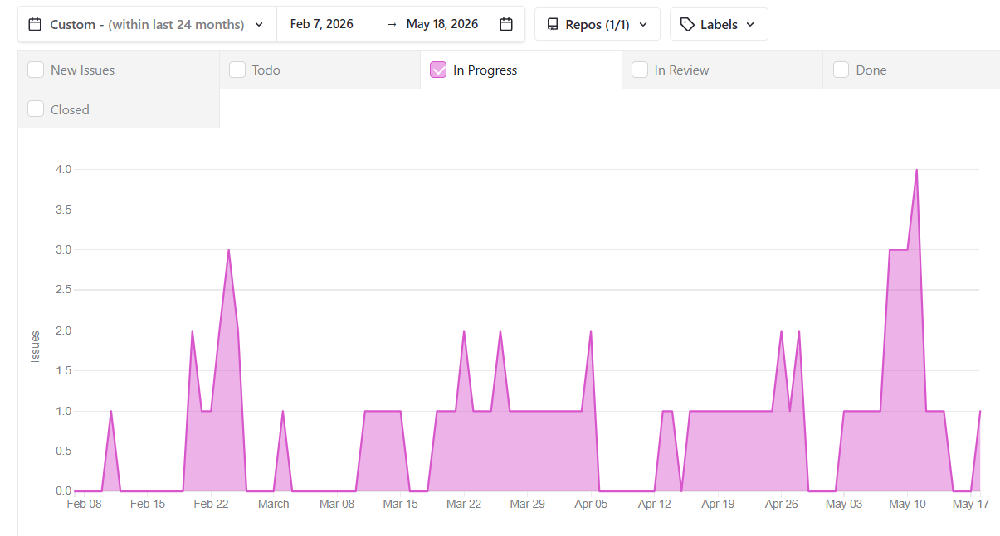

     
   <h1>Presentación desarrollada</h1>
    
   
     
   

      <strong>ASIGNATURA:</strong> PROCESO SOFTWARE Y GESTIÓN II 
      <strong>2025/2026</strong>  
      <strong>G6-63</strong> PETCLINIC 
      <strong>REPOSITORIO:</strong> HTTPS://GITHUB.COM/GII-IS-PSG2/PSG2-2526-G6-63
   

 

   <h3>Equipo de Desarrollo</h3>
   Pablo Reche Gabaldón 
   Diego Vicente Cámara 
   Ignacio Fuertes Montero 
   Mario Domínguez López 
   Diego José Rodríguez Fernández

 

## Índice

- [Presentación](#presentación)
- [Metodología de trabajo](#1-metodología-de-trabajo)
- [Adherencia a SCRUM](#2-adherencia-a-scrum)
- [Análisis de los Sprints anteriores](#3-análisis-de-los-sprints-anteriores)
- [Resumen de las retrospectivas](#4-resumen-de-las-retrospectivas)
- [Moral del equipo](#5-moral-del-equipo)
- [Evolución de métricas adicionales](#6-evolución-de-métricas-adicionales)
- [Conclusiones y lecciones aprendidas](#7-conclusiones-y-lecciones-aprendidas)

# Presentación

Este documento recoge de una forma más extendida y ordenada el contenido de la presentación a la que se dedica el Sprint 4. El objetivo del documento es servir como referencia de las ideas expuestas en la presentación, así como extender la información que se da en ella haciendo un análisis más en profundidad de lo que podría darnos tiempo a exponer.

# 1. Metodología de trabajo
En esta asignatura nuestro ritmo de trabajo y la adherencia del equipo a nuestra propia metodología ha cambiado conforme hemos ganado experiencia en el proyecto. Aunque al inicio del cuatrimestre nos hemos encontrado con dificultades a la hora de utilizar las plataformas para organizar el trabajo y la comunicación en el equipo ha tenido problemas, hemos conseguido superar estos problemas conforme nos hemos reunido para analizar nuestro trabajo y hemos tomado medidas al respecto.

Así, tras la evolución que hemos experimentado como equipo nuestra metodología básica de trabajo por Sprints se resume en los siguientes pasos:
  * **Reunión de análisis del Product Backlog**
    Al comienzo de cada Sprint es necesaria una reunión en la que esté presente todo el equipo de trabajo. En ella, estudiamos en grupo el Product Backlog y hacemos una lista de los objetivos a alcanzar, qué problemas creemos que podemos encontrar y la carga de trabajo que supone cada uno de ellos, haciendo las subdivisiones necesarias hasta alcanzar una lista de objetivos realistas. Una vez tenemos esta lista, hacemos un reparto equitativo de las tareas entre todos los miembros del equipo.
  * **Ciclo Desarrollo-Supervisión-Análisis**
    En esta fase se realiza el grueso del trabajo del Sprint. Se trata de una serie de ciclos semanales en los que nos esforzamos por, ante todo, mantener una buena comprensión sobre el trabajo a realizar, el trabajo realizado y los problemas encontrados para responder de forma efectiva. Las partes del ciclo son las siguientes:
    - **Desarrollo**: Los miembros del equipo trabajan individualmente en las tareas que tienen asignadas, tratando de avanzar tanto como sea posible en sus respectivas partes del proyecto. Aquí encontramos tanto trabajo de frontend, como trabajo de backend, documentación o mantenimiento del repositorio.
    - **Supervisión**: Al avanzar en sus tareas individuales y tratar de aplicar los cambios al repositorio, los cambios que ha realizado un miembro del equipo deben ser revisados por un miembro diferente para asegurar que todos los cambios cumplen la definición de hecho y se han aplicado correctamente. Ésto nos ha permitido detectar errores antes siquiera de introducirse al proyecto, y nos ha resultado una de las partes más útiles de la metodología.
    - **Análisis**: Mediante reuniones (Standups) que tratamos de tener dos veces a la semana, nos enfocamos en la comunicación del equipo. Asegurando que hay un flujo ágil de información entre todos los miembros podemos saber en qué estado se encuentra el proyecto, y con qué problemas nos podemos haber topado. Asimismo, nos permite poner ideas en común para la resolución de dichos problemas y saber si hay que tener en cuenta situaciones como sobrecargas de trabajo.
  * **Reunión de adaptación del Sprint Planning**
    Tras algunas fases de Desarrollo-Supervisión-Análisis, pasamos a la fase de adaptación en caso de que nos haya parecido necesario en las reuniones Standup. En las ocasiones en las que nos ha parecido que el Spring Planning ha resultado insuficiente, o que se han repartido las tareas de forma poco equilibrada por desconocimiento de la envergadura real de las mismas hemos hecho reuniones en las que hemos replanificado el trabajo teniendo en cuenta la información nueva de la que disponemos. 
    Al darnos esta flexibilidad de adaptar la estrategia de trabajo o incluso reestructurar las asignaciones de tareas hemos conseguido aprovechar al máximo las habilidades de cada miembro del equipo sin hacer que ninguno de ellos tenga que realizar cantidades poco razonables de trabajo.
  * **Estudio final del Sprint y entrega**
    En la semana anterior al final del Sprint realizamos estudios individualmente del estado del proyecto para asegurar la calidad del mismo y que todas las tareas han sido completadas satisfactoriamente. En caso de que algún miembro del equipo crea que haya alguna parte del proyecto a la que haga falta prestar más atención, o que la carga de trabajo que queda no es asumible al ritmo de trabajo actual, se hará una reunión en la que se definirá un plan de acción ("crunch") mediante el que poder alcanzar los objetivos a tiempo sin sacrificar ni la calidad del mismo ni la salud del equipo.

Por supuesto, esta metodología se apoya enormemente en las herramientas de seguimiento que nos ha ofrecido la asignatura, principalmente ZenHub para la organización de trabajo y la monitorización y seguimiento de las tareas a realizar. Además, toda la metodología específica de desarrollo está definida y resumida en los documentos correspondientes, realizados en el Sprint 1.

# 2. Adherencia a SCRUM
A la hora de comparar nuestra forma de trabajar con la que sigue un equipo SCRUM "de manual", la conclusión más honesta es que la propia obligación de adherirnos al marco nos ha forzado a estar mucho más organizados de lo que habríamos estado por defecto. En proyectos anteriores de otras asignaturas hemos planificado el trabajo de forma mucho más improvisada: no había un Scrum Master que se asegurase de que las reuniones se celebraran, no nos juntábamos para revisar avances y rara vez nos poníamos objetivos concretos del tipo "esta semana cada uno saca al menos una tarea adelante". El resultado era casi siempre el mismo: el proyecto se quedaba parado durante semanas y todo el peso acababa concentrándose en los días previos a la entrega.

En este proyecto, tener un Scrum Master definido y comprometernos a celebrar Sprint Plannings y Standups con cierta regularidad nos ha cambiado por completo esa dinámica. El Sprint Planning nos ha obligado, queramos o no, a sentarnos al inicio de cada Sprint, mirar el Product Backlog en conjunto y repartir tareas con un mínimo de criterio, en lugar de descubrir a mitad de Sprint que nadie estaba haciendo una parte importante. Los Standups, aunque no los hemos podido hacer diarios como manda SCRUM (compaginar la asignatura con el resto del curso lo hace inviable y los hemos celebrado una sola vez por semana), han cumplido su función: enterarnos a tiempo de que un compañero estaba bloqueado, redistribuir trabajo cuando alguien iba sobrado y, sobre todo, evitar que el proyecto se quedase silencioso durante días.

Donde más nos hemos desviado del SCRUM teórico es en la rigidez de los roles y en la frecuencia de las ceremonias. El Product Owner real ha sido el profesorado, así que no hemos tenido margen para priorizar el Backlog nosotros mismos, y el rol de Scrum Master ha sido menos estricto de lo que sería en un equipo profesional. Además, hemos permitido reuniones de replanificación a mitad de Sprint cuando hemos visto que la estimación inicial se nos quedaba corta, algo que SCRUM puro tiende a evitar, pero que en nuestro caso ha sido necesario por la falta de experiencia previa estimando con tecnologías nuevas para casi todos (como es el caso de Space por ejemplo, que nos ha llevado mucho tiempo implementarlo y de la ayuda de todos los miembros del grupo aunque la tarea estuviese asignada a uno solo).

Aun así, lo importante es que la base del marco —reunirnos, fijar objetivos por Sprint, revisar el trabajo de los compañeros antes de integrarlo y hacer retrospectiva al final— sí la hemos respetado, y es justamente lo que ha marcado la diferencia respecto a otras experiencias previas del equipo. Más que adherirnos a SCRUM por seguir la norma, hemos aprendido a valorar por qué existen esas ceremonias y esos roles: porque sin ellos un equipo de cinco personas con horarios distintos se desorganiza con una facilidad sorprendente.

# 3. Análisis de los Sprints anteriores
## Análisis de Rendimiento Global: Milestone Burndown Charts
Este apartado recoge el análisis evolutivo del rendimiento del equipo a lo largo de los tres sprints del proyecto PetClinic, utilizando como base las gráficas de Milestone Burndown generadas en ZenHub. El objetivo es demostrar la madurez adquirida en la gestión ágil del proyecto.

### Sprint 1: El error de las Épicas y el reporte tardío
* **Contexto visual:** Se proyecta la gráfica del S1, mostrando una línea plana durante la mayor parte del ciclo y una caída vertical abrupta al final, que incluso sobrepasa la fecha límite.

* **Narrativa / Guion:**
  Para empezar a analizar cómo ha rendido el equipo a lo largo del curso, vamos a fijarnos en nuestra evolución a través de los Burndown Charts de los tres Sprints. 
  
  Si miramos el **Sprint 1**, vemos una línea plana durante todo el ciclo y una caída completamente vertical al final, pasándonos incluso de la fecha límite por unos días. Esto no significa que no trabajáramos, sino que cometimos un error de gestión en ZenHub: asignamos los Story Points a las Épicas en lugar de a las tareas, y no las movimos a 'Done' hasta después del cierre. Esta gráfica nos enseñó una lección clave: si no actualizamos el tablero al día, la métrica pierde todo su valor para tomar decisiones.

### Sprint 2: Factores externos y cierres escalonados
* **Contexto visual:** Se proyecta la gráfica del S2. Se aprecian mesetas claras, pero con un patrón de caídas escalonadas, logrando finalizar a tiempo.

* **Narrativa / Guion:**
  Para el **Sprint 2**, corregimos ese error de las épicas y la gráfica empezó a mostrar una visibilidad mucho más real de nuestro trabajo. Como podéis ver, ya no es una sola caída al final, sino que vemos cierres escalonados.
  
  Aun así, la gráfica nos cuenta la realidad de nuestro mes: tuvimos un inicio plano por culpa del tiempo invertido en resolver las incidencias, y otra meseta a finales de marzo debido a la carga de exámenes externos del equipo. A pesar de estos bloqueos puntuales, logramos cerrar los 221 Story Points a tiempo.

### Sprint 3: La madurez del equipo
* **Contexto visual:** Se proyecta la gráfica del S3. La línea de trabajo restante sigue un patrón escalonado y continuo, ajustándose mucho más a la línea de trabajo ideal.

* **Narrativa / Guion:**
  Y finalmente, llegamos al **Sprint 3**. Aquí es donde se nota la madurez que hemos alcanzado como grupo.
  
  Fijaos cómo la línea azul de trabajo restante empieza a seguir muy de cerca a la línea gris ideal. Ya no hay grandes estancamientos de semanas enteras. El equipo, ya acostumbrado a la metodología, consiguió un ritmo de entrega de valor constante. Las caídas son mucho más frecuentes y pequeñas, lo que demuestra que desglosamos mejor las tareas y las fuimos terminando de forma continua a lo largo del Sprint, en lugar de acumularlo todo para el último día.

### Eficiencia y Flujo: Lead Time vs. Cycle Time
* **Contexto visual:** Se muestra una diapositiva limpia con una tabla comparativa de las medias de Lead Time y Cycle Time de los tres Sprints, sin las gráficas complejas de ZenHub.

| Sprint | Lead Time Medio (Creación -> Cierre) | Cycle Time Medio (In Progress -> Cierre) |
| :--- | :--- | :--- |
| **S1** | 14.5 días | 4.5 días |
| **S2** | 18.1 días | 1.3 días |
| **S3** | 20.3 días | 3.7 días |

* **Narrativa / Guion:**
  Para entender nuestra eficiencia técnica real, cruzamos los datos de Lead Time y Cycle Time. A simple vista, el **Lead Time** parece empeorar, subiendo de 14.5 a 20.3 días. Sin embargo, al analizar los datos, descubrimos que esto es un 'falso negativo'. Este aumento está condicionado por las tareas obligatorias de gestión, como las Retrospectivas o las Reviews, que abrimos el día 1 y estamos obligados a mantener abiertas hasta el final del sprint.
   
  La métrica que de verdad refleja nuestra agilidad como desarrolladores es el **Cycle Time**, es decir, el tiempo de desarrollo real. Aquí la historia es de éxito: pasamos de tardar 4.5 días de media en el S1 por cada issue, a bajar drásticamente a 1.3 días en el S2 y estabilizarnos en 3.7 días en el S3. Esto confirma que, una vez que el equipo coge una tarea técnica, la resolvemos y entregamos con gran rapidez.

### Caso de Estudio: Evolución de los Cuellos de Botella (Bottlenecks)

* **Contexto visual:** Se proyecta la gráfica de Bottleneck Tracking del Sprint 1 para evidenciar el origen del problema.

* **Narrativa / Guion:**
    Para entender por qué existía tanta diferencia en el Sprint 1 entre nuestro Cycle Time de solo 4.5 días y un Lead Time de   14.5 días, tenemos que analizar nuestro flujo de trabajo. La gráfica de cuellos de botella de la derecha es la evidencia perfecta de lo que nos ocurrió.
    
    Como podéis ver, se observa una gran acumulación de tareas en la columna azul de 'Todo' que se mantiene estancada durante casi todo el mes. El problema principal no fue la codificación, sino la gestión del flujo de cierre y las revisiones. El trabajo técnico se terminaba rápido, pero las tareas se quedaban bloqueadas en fases de validación cruzada y no se movían a 'Done' en ZenHub, acumulándose de manera artificial hasta provocar esa caída vertical masiva en los últimos días del sprint.
    
    Identificar este atasco administrativo gracias a las métricas fue el punto de inflexión para el equipo. Nos enseñó que ser rápidos completando tareas no sirve de nada si el flujo de valor se detiene en las revisiones, una lección clave que corregimos de inmediato para desbloquear el ritmo constante y escalonado que logramos en los siguientes ciclos.

### Aportación Individual y Cierre: Análisis de Clockify
* **Contexto visual:** Se proyectan las dos capturas de Clockify conjuntas: el gráfico de anillo con las horas totales por sprint y el desglose de barras horizontales por participante.

* **Narrativa / Guion:**
  Para cerrar este análisis, es fundamental demostrar cómo todas las métricas anteriores se sostienen sobre el esfuerzo real y conjunto del equipo G6-63. En total, hemos invertido prácticamente 435 horas de trabajo en el desarrollo de PetClinic.
  
  Si observamos el desglose individual de Pablo, Diego Vicente, Ignacio, Mario y Diego José, vemos que hay ciertas variaciones en el número total de horas registradas por cada uno, oscilando entre las 67 y las 103 horas. Queremos destacar que esto no refleja en absoluto un desequilibrio en la carga de trabajo, sino la realidad propia de la ingeniería de software: nos hemos repartido las responsabilidades por igual, pero algunas tareas técnicas o de investigación simplemente han requerido más tiempo de resolución para algunos de nosotros.
  
  A nivel interno, el desarrollo ha sido un éxito. No hemos tenido ningún problema o fricción con la carga de trabajo; todos hemos remado en la misma dirección, asumiendo tareas complejas y apoyándonos cuando alguien se quedaba bloqueado. 
  
  Estos datos, junto con la mejora continua que hemos visto en los ciclos anteriores, demuestran que hemos logrado consolidar una dinámica de trabajo ágil, sana y eficiente.

# 4. Resumen de las retrospectivas

Durante los tres sprints, el equipo ha mantenido siempre un muy buen ambiente de trabajo y una comunicación constante entre todos los miembros. Aunque al principio nos costó adaptarnos a la metodología y aplicar correctamente algunas prácticas, poco a poco fuimos mejorando y trabajando de forma más organizada.

En el Sprint 1, los principales problemas estuvieron relacionados con la organización: asignábamos tareas a varias personas, las issues eran demasiado grandes y no aplicábamos correctamente Git Flow ni algunas team practices. Aun así, ya destacábamos por la buena comunicación y las reuniones efectivas del equipo.

En el Sprint 2 empezamos a corregir muchos de esos problemas. Introdujimos métricas nuevas para medir mejor el trabajo y mejorar el seguimiento del sprint. También mejoramos bastante el uso de ramas, pull requests y revisiones. Además, vimos que dividir tareas grandes era muy importante para evitar sobrecarga y estrés.

En el Sprint 3 conseguimos aplicar correctamente la mayoría de las team practices y mejorar mucho el flujo de trabajo del equipo. También aprendimos a utilizar mejor herramientas como ZenHub, iTop,... para organizar el proyecto, monitorizar incidencias y requests, visualizar el progreso mediante gráficas y gestionar mejor el estado general del proyecto.

Como conclusión, creemos que la principal mejora del equipo fue la adaptación progresiva a la metodología y la mejora continua entre sprint y sprint. Además del desarrollo software, aprendimos conceptos muy útiles relacionados con gestión de configuración, gestión de servicios, customer agreements, métricas ágiles y trabajo colaborativo en proyectos reales.

Aun así, descubrimos que dividir y estimar tareas es mucho más complejo de lo que parece, especialmente en funcionalidades grandes, y sigue siendo uno de los aspectos más difíciles de gestionar correctamente.

---

# 5. Moral del equipo

## Sprint 1: La crisis del último minuto

Pasamos ahora a analizar la evolución de la moral del equipo. Como en el Sprint 1 la asignatura no nos exigía explícitamente el calendario Niko-Niko, realizamos una reconstrucción metodológica cruzando los datos analíticos de Clockify y ZenHub. El resultado, como puede verse en la gráfica, refleja el clásico "pánico de última hora".

Tuvimos un alarmante 68% de días sin actividad registrada en el proyecto. Esto se debió a dos factores: primero, una falsa sensación de calma al inicio; y segundo, al bloqueo metodológico que nos autoimpusimos al tener que desarrollar de forma independiente sobre la rama main local sin poder actualizar el repositorio. El miedo a pisar el código de los compañeros nos paralizó.

## Sprint 2: Curva de adaptación técnica

Las consecuencias emocionales fueron un colapso absoluto en las últimas 72 horas del sprint. Pasamos directamente de la inactividad al estrés agudo y la frustración extrema, acumulando jornadas de desarrollo intensas y reuniones de retoques que se prolongaron hasta casi la una de la madrugada del día de la entrega. Fue un severo toque de atención para el grupo.

Con las lecciones aprendidas, el Sprint 2 arrancó de una manera radicalmente distinta: con un 100% de optimismo y motivación en el primer día gracias a una planificación mucho más consciente en ZenHub. Sin embargo, la gráfica de este sprint nos muestra una auténtica "montaña rusa emocional".

Por un lado, conseguimos que casi la mitad del tiempo el equipo trabajara con una sensación fluida y satisfecha, reduciendo la inactividad al 43%. Pero si observan el tramo central de la gráfica, verán cómo aparecen picos de frustración extrema y preocupación.

Este bache anímico coincide exactamente con el "muro técnico" que supuso implementar Git Flow por primera vez y enfrentarnos a las revisiones por pares o peer reviews. Seguir correctamente la metodología de las ramas y gestionar los cuellos de botella en las Pull Requests ralentizó el ritmo de los desarrolladores. A pesar de esta volatilidad, lo positivo es que asimilamos el proceso y logramos estabilizar el ánimo del equipo en las jornadas finales.

## Sprint 3: Madurez y flujo sostenible

Llegamos finalmente al Sprint 3, que representa la consolidación y madurez operativa de este equipo. A simple vista se puede apreciar que el gráfico está dominado por un 62% de estado de ánimo neutral. En Scrum, un estado neutral es una excelente noticia: significa que el trabajo se ha vuelto predecible, diario y se desarrolla en un horario normal y saludable.

Es muy importante destacar que ese 14% de inactividad que se aprecia ya no se debe a dejar las tareas para el final. Al contrario, fue una inactividad planificada y pactada de mutuo acuerdo para descansar durante los días de la Feria de Sevilla. Esta gestión del descanso recargó la moral del grupo.

Por supuesto que hubo momentos de frustración y trasnoches, como las incidencias de fin de semana o los errores que sufrió un compañero con el framework de "Space" en la recta final. Pero la diferencia clave respecto al Sprint 1 es que este agotamiento final fue puramente técnico. El cansancio ya no venía provocado por una mala organización o por falta de comunicación, sino por la complejidad de los requisitos, afrontándose desde un flujo constante de actividad que el equipo ya dominaba por completo.

# 6. Evolución de métricas adicionales

## WIP

De las métricas adicionales definidas en el Sprint 2, la que mejor refleja nuestra evolución como equipo es la de **Work In Progress (WIP) medio**, es decir, el número medio de issues en estado *In Progress* a lo largo de cada Sprint. Recordemos que el Key Result que nos marcamos era ambicioso: mantener entre **3 y 5 tareas simultáneas en curso** durante el Sprint 3, aprovechando que el equipo tiene cinco miembros.

Mirando el Bottleneck Tracking de ZenHub para todo el proyecto (de febrero a mayo), la primera conclusión es que **la estimación fue claramente optimista**. Plantear que de media tuviésemos al menos tres tareas en progreso suponía implícitamente que el ritmo iba a ser tan constante que las tareas se terminarían bastante antes del cierre de cada Sprint, y la realidad es que no llegamos a ese nivel sostenido: durante la mayor parte de los días el WIP se ha movido entre 0 y 1, con picos puntuales de 2-3 e incluso un máximo de 4 en momentos concretos cercanos a las entregas. El objetivo de "3 a 5 tareas activas todos los días" exigiría un nivel de paralelización y de proactividad que, siendo realistas, no se corresponde con cómo trabaja un equipo de estudiantes que compagina la asignatura con el resto del curso.

Dicho esto, lo más interesante de la gráfica no es el valor absoluto, sino **la tendencia**. Durante el Sprint 1 (febrero) se ve con claridad lo que ya intuíamos en las retrospectivas: hay largos periodos en los que el WIP cae a cero y el proyecto se queda parado durante días, y casi todo el trabajo en progreso se concentra en un único pico al final del Sprint, alrededor del 22 de febrero. Es justo el patrón que SCRUM trata de evitar y que coincide con la fase en la que aún no habíamos interiorizado las ceremonias del marco.

A medida que entramos en el Sprint 2 (marzo-abril) la gráfica empieza a "llenarse": los huecos en blanco se acortan, aparecen picos más frecuentes de 1-2 tareas y el trabajo deja de concentrarse exclusivamente en el final del Sprint. En el Sprint 3 (abril-mayo) esta tendencia se consolida: el flujo es notablemente más constante, con tareas en progreso prácticamente todas las semanas y un pico final más alto que en los Sprints anteriores (llegando a 4 tareas simultáneas en torno al 10 de mayo), lo que indica que sí hemos sabido subir el ritmo cuando el cierre lo requería, pero ya partiendo de una base de actividad continua y no desde cero.

En resumen, aunque no hemos alcanzado el objetivo numérico del Key Result, sí hemos cumplido el espíritu que lo motivaba: pasar de un equipo que dejaba el proyecto parado durante grandes intervalos a un equipo con un flujo de trabajo mucho más sostenido y predecible. La principal lección aprendida es que **los Key Results deben fijarse en función de la baseline real del equipo y no de su capacidad teórica máxima**: para futuros Sprints (o futuros proyectos) tendría más sentido fijar un objetivo como "WIP medio ≥ 1.5 tareas" o "no más de N días consecutivos con WIP = 0", que es lo que realmente captura la mejora que hemos experimentado.

## PR Review Latency

Una de las métricas que más nos ayudó a detectar problemas reales fue la de **PR Review Latency**, es decir, el tiempo que tardaba una Pull Request en recibir una revisión.

En el Sprint 1, este tiempo estaba prácticamente “por las nubes”. Al principio no éramos conscientes de lo importante que era revisar y mergear rápido las PRs. Muchas tareas tenían relación con trabajo de otros compañeros, así que cuando una PR tardaba demasiado en revisarse, acababa bloqueando otras tareas y ralentizando el flujo de trabajo del equipo.

Además, en S1 y S2 la medición era bastante general y poco precisa, porque no hacíamos todavía un seguimiento sistemático. Estimábamos aproximadamente unos **3 días de media en S1** y unos **2 días en S2**.

A partir de ahí empezamos a darle mucha más importancia a las revisiones y al seguimiento de métricas. En el Sprint 3 registramos correctamente los tiempos y conseguimos una media aproximada de **44,6 horas**, es decir, menos de 2 días.

Esto mostró una mejora clara respecto a los primeros sprints y nos ayudó a mantener un flujo de trabajo mucho más estable.

---

## Estimation Accuracy

Otra métrica importante fue la precisión de las estimaciones durante el Sprint Planning.

En los primeros sprints realizábamos la evaluación de forma muy general, comparando simplemente la suma total de story points estimados inicialmente frente a la suma de puntos que realmente considerábamos necesarios al terminar el sprint.

Con el tiempo descubrimos que este enfoque tenía un problema importante: algunas tareas estaban sobreestimadas y otras infraestimadas, y al hacer el cálculo global los errores podían compensarse entre sí y dar la sensación de que la estimación había sido correcta.

Por eso, en Sprint 3 decidimos analizar también las métricas por épicas y funcionalidades concretas.

A nivel general, la división del trabajo durante el Sprint 3 fue bastante adecuada. La mayoría de épicas mantuvieron valores relativamente cercanos entre la estimación inicial y la final, lo que indica una mejora clara respecto a los primeros sprints. Aun así, seguimos detectando algunos problemas de organización y reparto en tareas concretas, especialmente en funcionalidades nuevas o más complejas, donde en ocasiones se dividieron tareas innecesariamente o se infravaloró la dificultad técnica real.

---

## Resultados Sprint 3

## Épica 3.2
- **Estimación inicial:** 26 SP  
- **Estimación final:** 28 SP  
- **Resultado:** bastante precisa  

La principal diferencia estuvo en la tarea **3.2.1**, que pasó de **3 a 5 puntos**.

---

## Épica 3.3
- **Estimación inicial:** 16 SP  
- **Estimación final:** 29 SP  

Aquí tuvimos una gran infraestimación, sobre todo en la tarea **3.3.2**, relacionada con **SPACE**, que terminó siendo mucho más compleja de lo esperado.

---

## Épica 3.4
- **Estimación inicial:** 26 SP  
- **Estimación final:** 26 SP  
- **Resultado:** bastante correcta (en teoria) pero...

Detectamos que una API se dividió entre backend y frontend cuando realmente no era necesario. La complejidad era la misma+ pero al final s hizo un reparto mal estructurado.~

---

## Épica 3.7
- **Estimación inicial:** 19 SP  
- **Resultado:** correcta  

---

## Épica 3.8
- **Estimación inicial:** 40 SP  
- **Estimación final ajustada:** 28 SP  

Las tareas relacionadas con requests estaban sobreestimadas. Las cinco tareas que inicialmente tenían **5 puntos** realmente eran más cercanas a **3 puntos** cada una. Además, la tarea **3.8.4** también resultó más sencilla de lo esperado.

---

## Épica 3.9
- **Estimación inicial:** 31 SP  
- **Estimación final:** 26 SP  

La tarea **3.9.4** estaba sobreestimada porque se dividió innecesariamente.

---

## Épica 3.10
- **Estimación inicial:** 23 SP  
- **Resultado:** correcta  

---

## Conclusión general

Gracias a estas métricas aprendimos que medir correctamente el trabajo y revisar continuamente el proceso es fundamental para mejorar como equipo.

También aprendimos que dividir tareas y estimarlas correctamente es mucho más complicado de lo que parece, especialmente en funcionalidades grandes o muy conectadas entre sí.

# 7. Conclusiones y lecciones aprendidas

A lo largo del desarrollo de este proyecto hemos crecido no solo como Ingenieros de Software sino como equipo de trabajo. Hemos aprendido la tremenda importancia de la monitorización del avance de proyectos mediante métricas objetivas, y de cómo esta importancia crece exponencialmente con el tamaño del equipo de desarrollo y la complejidad del proyecto.

La adaptación a un nuevo ciclo de trabajo y un nuevo entorno tecnológico es un paso duro para el ingeniero como individuo, pero el valor que otorga a la hora de obtener una visión general del proyecto es incalculable, y nos da la oportunidad de definir procesos de desarrollo robustos que minimizen la posibilidad de introducción de errores a la vez que agilicen enormemente la adaptación a cambios y problemas en la gestión.

Asimismo, hemos experimentado de primera mano lo que ayuda esta información a la hora de definir, mantener y adaptar Acuerdos de Servicio, así como la importancia de los mismos y lo crucial que es el priorizar el trato al cliente cuando estamos ofreciendo un servicio de este calibre. La enorme complejidad de una empresa que tiene que gestionar tanto el desarrollo y mantenimiento de un proyecto como las incidencias y peticiones de servicio es completamente inasumible sin la ayuda de sistemas de información como los estudiados en la asignatura, son vitales para su buen funcionamiento.

Una vez más hemos aprendido nuevos matices del significado del trabajo en equipo, y de la importancia de la comunicación en un proyecto así. Los problemas que hemos tenido en el primer Sprint a la hora de mantener la comunicación ágil y de usar correctamente las herramientas de seguimiento de trabajo sólo han servido para demostrarnos la importancia de la evolución contínua de la metodología de trabajo, así como de la importancia de que cada miembro del equipo se esfuerce para seguir las pautas definidas por todo el grupo.

En conclusión, consideramos que hemos crecido enormemente como Ingenieros en la realización de este proyecto, y que hemos profundizado de forma importante en nuestra comprensión de las metodologías de trabajo, el seguimiento del mismo y las CMDB, por no hablar del uso de herramientas de análisis como SonarQube, o el estudio de el Software como Servicio y todo lo que ello conlleva. Estamos convencidos de que nos servirá como una base sólida para continuar nuestra formación en el futuro. 

---

  ASIGNATURA: PROCESO SOFTWARE Y GESTIÓN II | CURSO: 2025/2026 | GRUPO: G6-63 PETCLINIC | REPOSITORIO: HTTPS://GITHUB.COM/GII-IS-PSG2/PSG2-2526-G6-63

